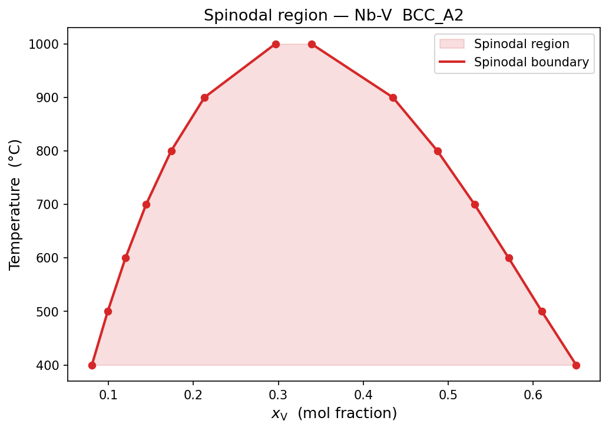
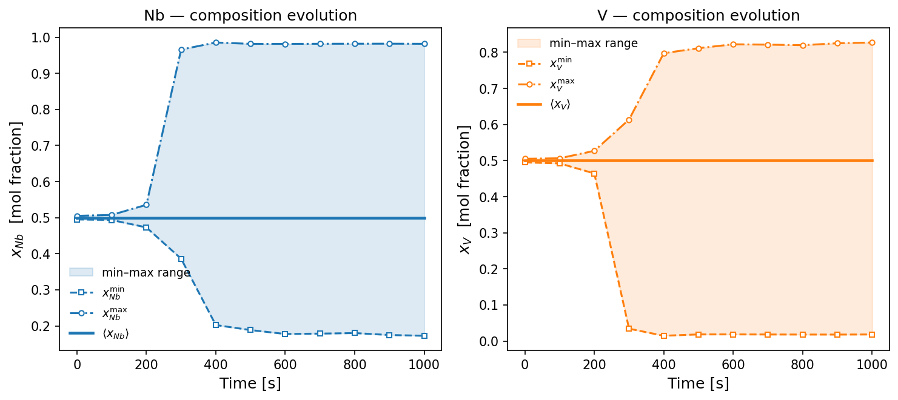
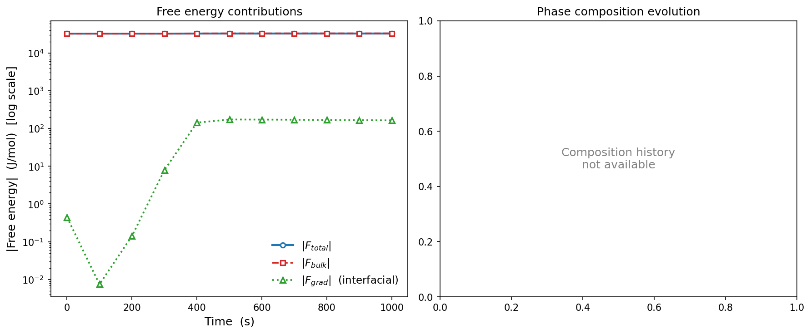
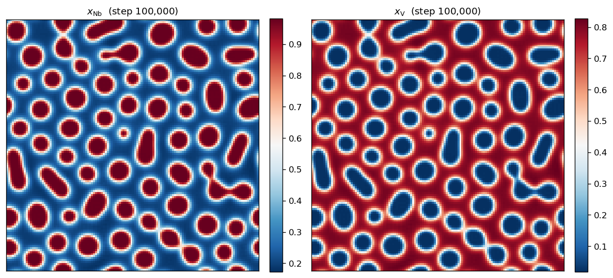

# Tutorial: your first 2D PhaseFoundry simulation (binary Nb-V)

This walks through the full pipeline — thermodynamic data, surrogate fitting,
phase-field simulation, post-processing — on the simplest possible system: a
2D, chemical-only (no elastic coupling) simulation of spinodal decomposition
in binary Nb-V at 500 °C. Every command below was actually run to produce
this document; the figures are real output, not mockups.

Expected total time: ~2 minutes, almost all of it Step 3.

---

## What you'll build

A 2D Cahn-Hilliard simulation that predicts spinodal decomposition in Nb-V
directly from CALPHAD thermodynamics — not a hand-fit double-well potential.
The chemical potentials and Hessian driving the simulation are the *exact*
analytic (Jansson) derivatives of the real Nb-V free-energy surface.

### The equation being solved

PhaseFoundry integrates the conserved Cahn-Hilliard equation

```
∂c/∂t = ∇ · ( M(c) ∇μ ),      μ = ∂G_m/∂c − κ ∇²c
```

for the single independent composition field `c = x_Nb` (`x_V = 1 − c`). `μ`
is the variational derivative of the total free-energy functional
`F[c] = ∫ [ G_m(c) + (κ/2)|∇c|² ] dV`, so it has two parts: a bulk
chemical-potential term `∂G_m/∂c`, and a gradient-energy term `−κ∇²c` that
penalizes sharp interfaces (`κ` sets the interface width/energy, same `κ`
as in the config file).

What makes this "not a hand-fit double-well": `G_m(c)` is the real CALPHAD
molar Gibbs energy of BCC_A2 Nb-V at 500 °C, from `pycalphad`, and
`∂G_m/∂c` is the exact *analytic* (Jansson) derivative of that database —
not a finite-difference approximation of a fitted polynomial. That's also
exactly what `H_NBNB` in Step 3 below is: the second derivative
`∂²G_m/∂c²` evaluated at `c₀`, i.e. the local curvature of this same
`G_m(c)`. Its sign determines spinodal instability directly — negative
means unstable, which is the whole phenomenon this tutorial demonstrates.

The mobility is degenerate: `M(c) = M̊ · c · (1 − c)`, vanishing at `c = 0`
and `c = 1` (pure Nb or pure V has zero diffusivity, as it physically
should) and peaking at `c = 0.5`. `M̊` is the constant mobility coefficient
set in the config (`M: 5.0e-21`).

Numerically, the PDE is solved pseudo-spectrally (FFT in space) with a
semi-implicit Eyre convex-splitting time scheme: the bulk chemical term is
split into a stabilizing linear part, handled implicitly, plus the
remaining nonlinear part, handled explicitly, using a stabilization
constant `A ≥ max(0, −∂²G_m/∂c²)` evaluated over the composition range —
the `Stabilization A_NB` value Step 3 prints below. This is what lets `dt`
be chosen well above the naive explicit-scheme stability limit without the
scheme blowing up, at the cost of needing `dt` small enough relative to
`dt_stable` that individual field values stay physical (see the
`dt_stable` vs. `dt` discussion in Step 3, and the common-failure-mode
table at the end of this page).

This binary case is the `N = 2` instance of the general `N`-component
solver — see the
[`solve_cahn_hilliard()` docstring](https://github.com/vahid2364/PhaseFoundry/blob/develop-new/src/phasefoundry/phasefield/solver.py#L1-L40)
for the full multicomponent mobility-matrix form used in the
[ternary tutorial](tutorial_2d_ternary_elastic.md).

## Prerequisites

```bash
git clone https://github.com/vahid2364/PhaseFoundry.git
cd PhaseFoundry
pip install -e .
pf-simulate --help   # should print usage, not an error
```

See [Installation](installation.md) for the full dependency list, optional
extras (`python-ternary`, `cupy`), and troubleshooting.

## The pipeline, conceptually

Querying CALPHAD (via `pycalphad`) at every grid point of every simulation
time step would be far too slow — a single equilibrium call is an iterative
minimization. So the pipeline front-loads that cost:

```
PhaseForge TDB
   └─ Step 1  ─  pycalphad → HDF5 thermodynamic tables  (G_m, μ, ∂μ/∂x)
   └─ Step 2  ─  HDF5 → fast interpolant surrogate + spinodal boundary
   └─ Step 3  ─  surrogate → Cahn-Hilliard PFM simulation (pseudo-spectral)
   └─ Step 4  ─  simulation output → post-processing and figures
```

Step 1 queries CALPHAD once, on a dense composition grid, and caches the
result. Step 2 fits a smooth, cheap-to-evaluate surrogate to that cache.
Only then, in Step 3, does the actual PDE integration happen — millions of
surrogate queries, zero direct CALPHAD calls.

All of this is driven by one YAML config. We'll use the canonical example,
`configs/nb_v_chem_c50.yaml` (`c50` = mean composition x_Nb = 0.50).

---

## The config file

Full contents of `configs/nb_v_chem_c50.yaml`:

```yaml
system:
  name:              nb_v
  db_path:           data/tdb/HfNbTiV_BCC_PhaseForge_v2_Tdep.tdb
  elements:          [NB, V]
  phase:             BCC_A2
  reference_element: V

thermo:
  composition_ranges:
    NB: [0.001, 0.999]
  n_points:          200
  temperatures_C:    [500]

simulation:
  temperature_C: 500
  dimensions:    2
  N:             128
  Lx:            1.0e-6
  kappa:         1.0e-12
  M:             5.0e-21
  c0:            0.50              # mean x_NB (independent field; x_V = 1 - x_NB)
  noise:         0.01
  seed:          42
  dt:            1.0e-2
  derivative_method: jansson
  use_gpu:           false
  adaptive_dt:       false
  n_steps:       100000
  save_every:    10000

output:
  data_dir:      data/HfNbTiV_BCC_PhaseForge_v2/NbV
  results_dir:   results/HfNbTiV_BCC_PhaseForge_v2/NbV
  run_name:      auto
```

**Where paths resolve from — two different rules:**

1. **The `--config` argument itself** (`configs/nb_v_chem_c50.yaml` on the
   command line) is resolved relative to **your current working directory**
   when you run the command. Every command in this tutorial assumes you're
   sitting at the repo root — that's why they all look like
   `pf-generate --config configs/....yaml` rather than an absolute path.

2. **Every path *inside* the YAML** (`db_path`, `data_dir`, `results_dir` —
   anything in the `system:` or `output:` sections that looks like a path)
   is resolved relative to the **repository root**, not your current working
   directory and not the config file's own location. This happens in
   [`resolve_paths()`](https://github.com/vahid2364/PhaseFoundry/blob/develop-new/src/phasefoundry/config.py#L200) (`src/phasefoundry/config.py:200`), which each
   workflow script calls after computing
   `_ROOT = Path(__file__).resolve().parents[2]` — i.e. "two directories up
   from `workflows/<step>/run.py`" — so it's anchored to the repo's
   structure, not to whatever directory you happened to launch the command
   from. That's why `db_path: data/tdb/HfNbTiV_BCC_PhaseForge_v2_Tdep.tdb`
   above becomes the absolute path you see printed in Step 1's config dump
   below, even if you'd run the same command from a different directory
   with `--config /some/other/path/nb_v_chem_c50.yaml`.

In practice this means: write every path inside a config relative to the
repo root (as the existing configs do), and run `pf-*` commands from the
repo root so the `--config` argument itself resolves correctly too.

---

## Step 1 — generate thermodynamic tables

```bash
pf-generate --config configs/nb_v_chem_c50.yaml
```

**What it does:** calls `pycalphad` to compute G_m, μ, and ∂μ/∂x for Nb-V
BCC_A2 at 500 °C across the full composition range, and saves the result to
an HDF5 file under `data/HfNbTiV_BCC_PhaseForge_v2/NbV/`.

**What you'll see:**

```
── Step 1: Generate thermodynamic tables ──
   System : nb_v  (2 components, 1 independent field(s))
Active configuration:
────────────────────────────────────────
  [system]
    name                   nb_v
    db_path                .../data/tdb/HfNbTiV_BCC_PhaseForge_v2_Tdep.tdb
    elements               ['NB', 'V']
    ...
   500.0 °C  →  computing ...   (or "exists, skipping" if already cached)

Done. 1 tables in .../data/HfNbTiV_BCC_PhaseForge_v2/NbV
```

It always prints the fully-resolved config first — a quick way to sanity
check what's actually about to run before committing to it.

---

## Step 2 — fit the surrogate and check the spinodal boundary

```bash
pf-surrogate --config configs/nb_v_chem_c50.yaml
```

**What it does:** fits a smooth spline to G_m(x) at every available
temperature, then computes where the Gibbs-energy curvature d²G/dx² changes
sign — the spinodal boundary. Everything inside that boundary is locally
unstable and will spontaneously phase-separate.

**What you'll see** (console, abbreviated):

```
── Step 2: Build G_m interpolant ──
  Found 9 temperature table(s).
  Fitting G_m spline surrogate ...
T = 773.1 K (500.0 °C)  |  Gm spline built on 200 pts  x_V=[0.0010, 0.9990]
  ...
  Computing spinodal/binodal boundaries ...
Saved figure to .../NbV/phase_diagram.png
Saved figure to .../NbV/GM_all.png
Saved figure to .../NbV/500C/thermodynamics/spinodal.png
```



This is the actual output. The dome shows where Nb-V is unstable at each
temperature — at 500 °C it spans roughly x_V ∈ [0.08, 0.65]. **Our chosen
composition, x_V = 0.50, sits well inside the dome**, so it's guaranteed to
decompose. If you pick a different `c0` in the config, check this plot first
— outside the dome, nothing will happen in Step 3, and that's correct
behavior, not a bug.

---

## Step 3 — run the simulation

```bash
pf-simulate --config configs/nb_v_chem_c50.yaml
```

**What it does:** integrates the Cahn-Hilliard equation on a 128×128 grid
for 100,000 time steps (1,000 s of physical time), using the surrogate from
Step 2 for the chemical driving force at every grid point and every step.

**What you'll see** (console, abbreviated):

```
── Step 3: Phase-field simulation ──
  Temperature: 500 °C  →  matched 500.0 °C in data
  Dimensions: 2D  (128×128 grid)
  Derivative method: 'jansson'  |  Surrogate backend: 'auto'
  FFT backend: NumPy (CPU)
  dt_stable = 1.8325e-01 s  |  dt used = 1.0000e-02 s
  [progress bar runs through 100,000 steps]
  Elapsed: 76.4 s
```

Two numbers worth understanding immediately:
- **`dt_stable` vs. `dt` used** — the solver reports the time step it
  computed as formally stable (0.183 s here) alongside the one actually used
  (0.01 s, set in the config). A healthy run has `dt` comfortably below
  `dt_stable` — here it's 18× smaller, a wide safety margin. If `dt` is
  *larger* than `dt_stable`, the run is relying entirely on the solver's
  energy-stability guarantee rather than a formal margin — not necessarily
  wrong, but worth knowing, and it's where field values pushing outside
  [0, 1] becomes a real risk.
- **The Hessian eigenvalue it logs** (`sim_params.txt` in the output
  directory) — here `λ_min = -7239.3 J/mol (UNSTABLE)`, confirming the
  solver itself agrees this composition should decompose, consistent with
  being inside the Step 2 spinodal dome.

Three figures land in `results/.../kinetics/<run_name>/`:



The min/max composition range (shaded) starts pinned near 0.50 (the initial
noise amplitude), visibly splits apart starting around t ≈ 200 s, and is
fully separated — x_Nb ranging roughly [0.17, 0.98] — by t ≈ 400 s. The
solid mean line stays exactly at 0.50 the entire time: **mass is conserved**,
a basic correctness check that's always worth glancing at.



The gradient-energy term (green, dotted) tracks the story directly: near
zero while the field is still nearly uniform, rising sharply as sharp
interfaces form during the same t ≈ 200–400 s window, then plateauing once
the pattern stops changing topology and just coarsens slowly.



The field at the final step (t = 1,000 s) — textbook spinodal decomposition:
isolated Nb-rich droplets (dark red, x_Nb) in a continuous V-rich matrix,
each interface sharp and well-resolved by the 128×128 grid.

---

## Step 4 — post-process

```bash
pf-postprocess --config configs/nb_v_chem_c50.yaml
```

**What it does:** re-renders the free-energy history, builds a d²G/dx² vs.
T summary figure, and generates a publication-style composition
microstructure figure directly from the saved simulation snapshots.

**What you'll see:**

```
── Step 4: Post-processing ──
  Saved → .../free_energy_history.png
  Saved → .../500C/thermodynamics/d2G_vs_T.png
Saved microstructure figure to .../microstructure.pdf

Done.
```


This is the STEM-style figure format used for publication: a main panel
(here, x_V) with a cropped inset of the complementary field (x_Nb) and a
scale bar, generated automatically from the raw `fields.npz` the simulation
saved — no manual plotting required.

---

## Interpreting the result

A successful chemical-only spinodal run should show, in order:
1. A near-uniform field at t = 0 (just the initial noise).
2. A period of exponential-looking growth in composition contrast and
   gradient energy — the linear-instability regime.
3. Sharp interfaces forming and the domain pattern locking in.
4. Slow coarsening afterward (domains merging/growing, interface count
   decreasing) without the overall contrast or mean composition changing.

If instead the field stays uniform the whole run: check that your `c0` is
actually inside the Step 2 spinodal dome.

## Common failure modes

| Symptom | Likely cause |
|---|---|
| Field never decomposes, stays near-uniform | `c0` is outside the spinodal boundary (check Step 2's `spinodal.png`) — this may be *correct* behavior, not a bug |
| `FileNotFoundError` on `db_path` at Step 1 | Config points at a `.tdb` filename that doesn't exist — check `data/tdb/` for the exact filename (watch for `_Tdep` suffixes) |
| Simulation runs but composition exceeds [0, 1] | `dt` used is much larger than the reported `dt_stable` — the run is relying on the Eyre scheme's energy-stability guarantee alone, which doesn't bound individual field values; reduce `dt` |
| Free energy increases over the run | Numerical instability — reduce `dt` or increase the Eyre stabilization constant |
| Step 1 is slow every time, never says "skipping" | `data_dir`/output paths changed between runs, or the HDF5 file is being regenerated each time — check `output.data_dir` in the config |

## Where to go next

- **Ternary + elastic coupling** — see the [2D ternary elasto-chemical tutorial](tutorial_2d_ternary_elastic.md) (or Mode 3 in the main [README](https://github.com/vahid2364/PhaseFoundry/blob/develop-new/README.md#mode-3--ternary-elasto-chemical-2d)) for coherency-strain-coupled spinodal decomposition in Nb-Hf-V.
- **Quaternary systems** — Mode 4 in the README, Hf-Nb-Ti-V.
- **Checking surrogate accuracy** — `pf-validate` compares the `fd`/`jansson`/`hybrid` derivative methods against raw CALPHAD data for your system.
- **Enabling structured logging** — add a `logging:` block to your config (see `configs/nb_v_pipeline_test.yaml`) for timing records, config/TDB fingerprinting, and an automatic free-energy monotonicity check.
