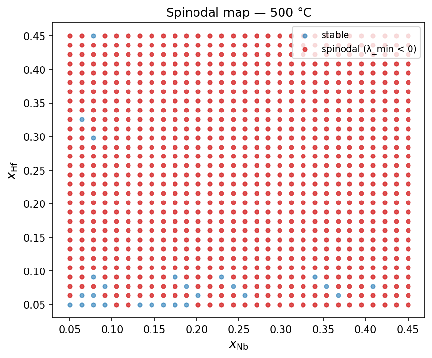
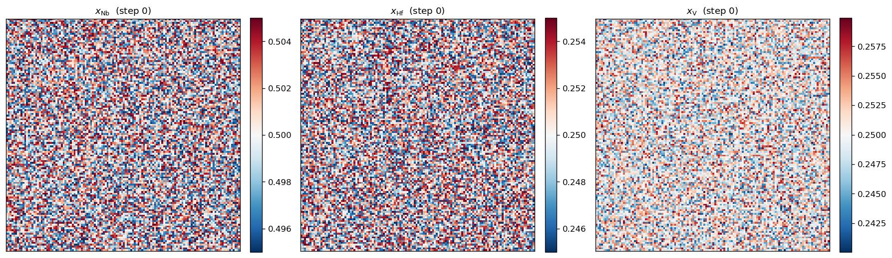
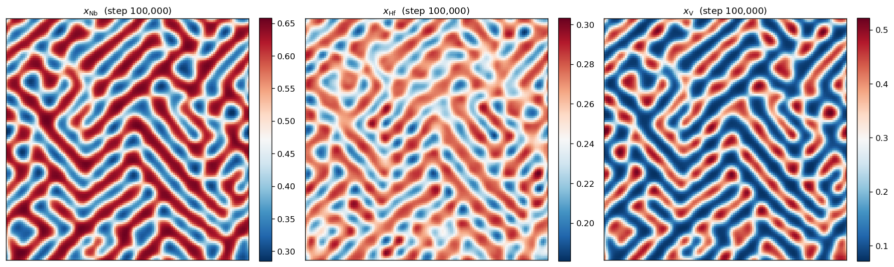
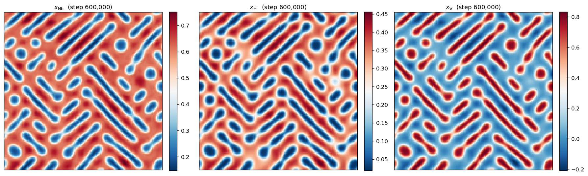
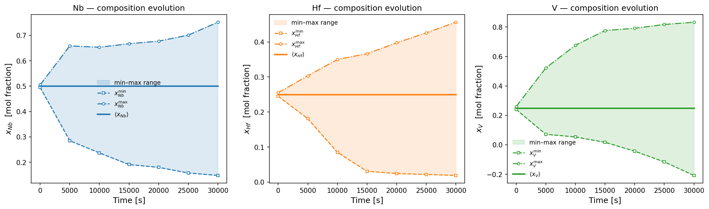
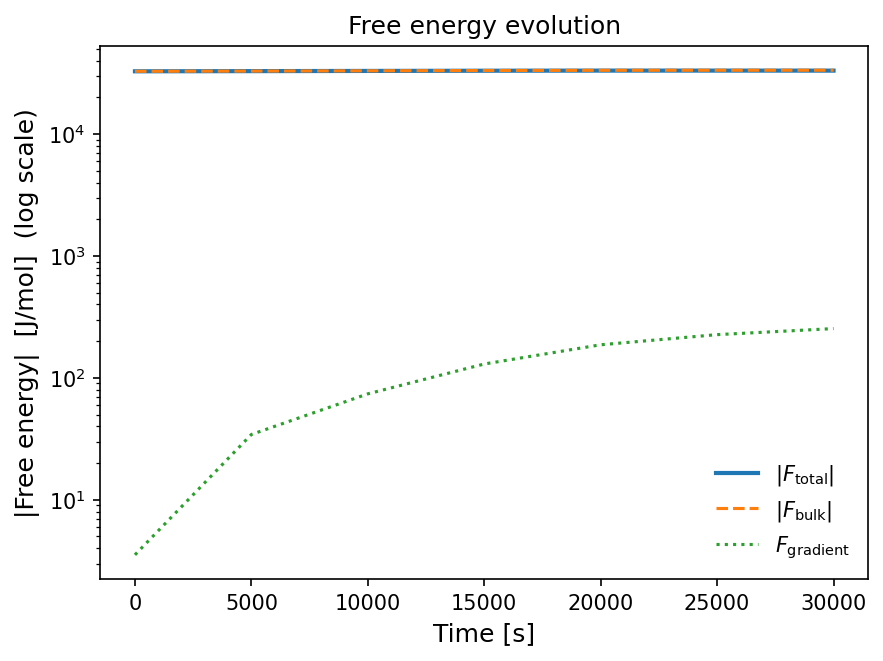

# Tutorial: elasto-chemical spinodal decomposition (ternary Nb-Hf-V)

This is the natural second tutorial after the [2D binary walkthrough](tutorial_2d_binary.md):
same pipeline, but now in a ternary system (Nb-Hf-V) with **coherency-strain
coupling turned on** — the capability that actually distinguishes this toolkit
from a hand-fit double-well phase-field model. Composition-dependent elastic
constants (from SQS/MLIP calculations) and a tensorial Vegard eigenstrain feed
a spectral micromechanics solver that couples back into the Cahn-Hilliard
dynamics every few time steps.

Every command and number below was actually run on this machine; the figures
are real output. Unlike the binary tutorial, this one isn't a 2-minute run —
the full production configuration takes **about 2 hours** on CPU (see
[Step 3](#step-3-run-the-simulation) for why, and for a cheaper way to check
things first).

---

## What you'll build

A 2D Cahn-Hilliard simulation of Nb-Hf-V (x_Nb = 0.50, x_Hf = 0.25, x_V = 0.25)
at 500 °C, where the chemical driving force comes from the exact Jansson
derivatives of the CALPHAD free-energy surface (as in the binary tutorial),
*and* the interfaces are additionally driven/resisted by coherency elastic
strain energy from a composition-dependent cubic stiffness tensor and Vegard
eigenstrain.

## Prerequisites

Same as the [binary tutorial](tutorial_2d_binary.md#prerequisites) — see
[Installation](installation.md) if you haven't already done `pip install -e .`.
This tutorial additionally needs `python-ternary` installed if you want to
regenerate the Step 2 spinodal-map figure yourself (see
[Optional dependencies](installation.md#optional-dependencies)).

---

## The config file

Full contents of `configs/nb_hf_v_elastic_cNb50V25Hf25.yaml` (this is the
exact "Mode 3" example in the main [README](https://github.com/vahid2364/PhaseFoundry/blob/develop-new/README.md#mode-3--ternary-elasto-chemical-2d)):

```yaml
system:
  name:              nb_hf_v
  db_path:           data/tdb/HfNbTiV_BCC_PhaseForge_v2_Tdep.tdb
  elements:          [NB, HF, V]        # V is reference; NB and HF are independent
  phase:             BCC_A2
  reference_element: V

thermo:
  composition_ranges:
    NB: [0.001, 0.999]                  # independent element 1
    HF: [0.001, 0.999]                  # independent element 2
  n_points:          20                 # 20×20 grid → ~210 valid simplex points
  temperatures_C:    [500]

simulation:
  temperature_C: 500
  dimensions:    2
  N:             128
  Lx:            1.0e-6

  # Gradient energy: one κ per independent field [J·m²/mol]
  kappa:         [1.0e-12, 7.0e-12]     # kappa[0] → x_NB, kappa[1] → x_HF

  # Mobility matrix 2×2 [m⁵/(J·s)]
  # M_HF ~100× smaller than M_NB: Hf is larger and diffuses slower at 500 °C.
  M:
    - [5.0e-21, 0.0    ]              # M_NbNb, M_NbHf
    - [0.0,     5.0e-23]              # M_HfNb, M_HfHf

  c0:            [0.50, 0.25]         # [x_NB, x_HF] (x_V = 1 - x_NB - x_HF)
  noise:         0.01
  seed:          42
  dt:            0.05
  derivative_method: jansson
  use_gpu:           false
  adaptive_dt:       false
  n_steps:       600000
  save_every:    100000

  elastic:
    enabled:      true
    stiffness_model: cubic_csv          # reads C_ij from CSV, interpolates to local composition
    eigenstrain_model: local_vegard     # Vegard eigenstrain: ε* = Λ · δc
    elastic_csv:  data/HfNbTiV_BCC_PhaseForge_v2/sqs_elastic_constants_HfNbVTi-orb-v2.csv

    # Approximate tie-line endpoints — placeholder estimates, not a verified
    # CALPHAD-computed tie-line (see the caveat in Step 1b below).
    c_mat: {NB: 0.70, HF: 0.10, V: 0.20}
    c_ppt: {NB: 0.15, HF: 0.35, V: 0.50}

    solve_every:  10        # re-solve elasticity every N time steps
    warm_start:   true      # initialize elastic solver from previous solution
    tol:          1.0e-5
    max_iter:     500
    save_fields:  true

output:
  data_dir:      data/HfNbTiV_BCC_PhaseForge_v2/NbHfV
  results_dir:   results/HfNbTiV_BCC_PhaseForge_v2/NbHfV
  run_name:      auto
```

**Where paths resolve from** (same two rules as the binary tutorial, repeated
here because it matters more with the extra `elastic_csv` path):

1. The `--config configs/....yaml` argument on the command line is resolved
   relative to **your current working directory** — run these commands from
   the repo root.
2. Every path *inside* the YAML — `db_path`, `data_dir`, `results_dir`, and
   (for this config specifically) `elastic.elastic_csv` — is resolved
   relative to the **repository root**, regardless of where you ran the
   command from. `db_path: data/tdb/HfNbTiV_BCC_PhaseForge_v2_Tdep.tdb`
   becomes `<repo_root>/data/tdb/HfNbTiV_BCC_PhaseForge_v2_Tdep.tdb`, and
   `elastic_csv: data/HfNbTiV_BCC_PhaseForge_v2/sqs_elastic_constants_HfNbVTi-orb-v2.csv`
   becomes `<repo_root>/data/HfNbTiV_BCC_PhaseForge_v2/sqs_elastic_constants_HfNbVTi-orb-v2.csv`.
   This happens via `resolve_paths()` for the `system:`/`output:` sections
   (`src/phasefoundry/config.py:200`), and via the same `_ROOT`-relative join
   applied explicitly to `elastic_csv` in
   `workflows/01b_lookup_elastic/run.py:272-273`. `_ROOT` itself is computed
   from `Path(__file__).resolve().parents[2]` inside each workflow script —
   i.e. it's anchored to the repo's own file layout, not to `os.getcwd()`.

So: write every path in a config relative to the repo root, and run `pf-*`
from the repo root.

---

## The pipeline (one extra step vs. the binary case)

```
PhaseForge TDB
   └─ Step 1   ─  pycalphad → HDF5 thermodynamic tables  (G_m, μ, ∂μ/∂x)
   └─ Step 1b  ─  SQS/MLIP  → elastic constant tables (C_ij, lattice parameter)   ← new
   └─ Step 2   ─  HDF5 → surrogate + spinodal boundary
   └─ Step 3   ─  surrogate + elasticity → Cahn-Hilliard PFM simulation
   └─ Step 4   ─  simulation output → post-processing and figures
```

Step 1b is the only addition relative to the binary pipeline: it reads a CSV
of SQS/MLIP-computed elastic constants, interpolates C₁₁/C₁₂/C₄₄ and the
lattice parameter at the matrix and precipitate compositions you specify,
runs a Born-stability check, and derives the tensorial Vegard eigenstrain.
Step 3 then reads that output (`elastic_params.yaml`) automatically.

---

## Step 1 — generate thermodynamic tables

```bash
pf-generate --config configs/nb_hf_v_elastic_cNb50V25Hf25.yaml
```

This system's thermodynamic tables were already cached from an earlier run
(the README notes Step 1 output is shared across configs for the same TDB
and composition space), so this printed `500.0 °C → exists, skipping` and
finished in under 4 seconds. On a cold cache, expect the same per-temperature
`pycalphad` equilibrium cost as the binary tutorial, just on a 20×20 grid
instead of a 1D sweep.

---

## Step 1b — look up elastic constants and check Born stability

```bash
python workflows/01b_lookup_elastic/run.py --config configs/nb_hf_v_elastic_cNb50V25Hf25.yaml
```

**What it does:** interpolates the SQS/MLIP elastic-constants CSV (1771 rows,
filtered to 231 rows in the Nb-Hf-V subspace) at the matrix composition
(Nb70-Hf10-V20) and precipitate composition (Nb15-Hf35-V50) you specified
under `elastic.c_mat`/`elastic.c_ppt`, checks Born mechanical-stability
criteria, and derives the Vegard eigenstrain tensor.

**Actual output:**

```
Born stability check:
  C_mat:  C11=214.5  C12=120.0  C44=17.4 GPa
    [OK  ] C44_positive
    [OK  ] C11_gt_C12
    [OK  ] bulk_positive
    [OK  ] all_stable
  C_ppt:  C11=199.0  C12=115.2  C44=45.4 GPa
    [OK  ] C44_positive
    [OK  ] C11_gt_C12
    [OK  ] bulk_positive
    [OK  ] all_stable

Vegard eigenstrain (tensorial Λ):
  a_mat = 3.2859 Å  |  a_ppt = 3.2651 Å
  eps_T (endpoints) = -0.00635 (-0.64%)
  α_NB = 0.083326  (eigenstrain per unit x_NB)
  α_HF = 0.158995  (eigenstrain per unit x_HF)

Zener anisotropy:
  A_Z_mat = 0.368  |  A_Z_ppt = 1.085
  A_Z < 1 → diamond morphology expected (⟨100⟩ corners)
```

Both endpoint compositions pass every Born stability check, so the stiffness
tensors used downstream are at least mechanically well-posed. The matrix
phase's Zener anisotropy ratio A_Z = 0.368 is well below 1 — this predicts
elastically-driven microstructures elongated along ⟨100⟩-type directions
rather than isotropic circular precipitates, which is exactly what shows up
in Step 3's final microstructure below.

> **Caveat already flagged in the config itself:** `c_mat`/`c_ppt` here are
> placeholder tie-line endpoints, not a CALPHAD-computed tie-line for this
> parent composition — the config comments note they don't actually
> mass-balance against Nb50Hf25V25 (this is the same issue Reviewer 4 caught
> in the Kunselman paper's Table 6). Run
> `workflows/01c_calphad_tieline/run.py` or inspect the ternary phase map
> from `workflows/01d_phase_map` before trusting these quantitatively — for
> this tutorial they're good enough to demonstrate the mechanism.

---

## Step 2 — fit the surrogate and check the spinodal region

```bash
pf-surrogate --config configs/nb_hf_v_elastic_cNb50V25Hf25.yaml
```

Built 8 temperature tables (300-1000 °C) and saved a ternary spinodal map
among other figures.



Almost the entire sampled (x_Nb, x_Hf) window at 500 °C is spinodally
unstable (red); the handful of scattered stable (blue) points are isolated
and likely numerical noise near the sampling resolution rather than a real
stable pocket. Our chosen composition, (x_Nb, x_Hf) = (0.50, 0.25), sits well
inside the unstable region.

---

## Step 3 — run the simulation

```bash
pf-simulate --config configs/nb_hf_v_elastic_cNb50V25Hf25.yaml
```

**Why this is slow:** 600,000 steps at 2D 128×128 resolution, with the
spectral elasticity solver re-solved every 10 steps (60,000 elasticity
solves, each an iterative Lippmann-Schwinger FFT scheme up to 500
iterations). On this machine (NumPy/CPU FFT backend, no GPU): **7662 s
(~2h08m) wall time.** A 2000-step timing probe beforehand ran at ~206
steps/s, which is what the ~2 h estimate for the full 600,000-step run was
based on before committing to it.

**If you just want to see the mechanism work, not reproduce the production
run:** override step count on the command line and it finishes in seconds —

```bash
pf-simulate --config configs/nb_hf_v_elastic_cNb50V25Hf25.yaml \
  --set simulation.n_steps=2000 simulation.save_every=1000
```

(2000 steps = 100 s physical time here, at ~10 s wall time — enough to
confirm the pipeline runs end-to-end and inspect the printed diagnostics
below, but not long enough to see real decomposition; see the Hessian
eigenvalues and the dt_stable/interface-resolution notes below for why.)

**Diagnostics worth reading before trusting any run** (from `sim_params.txt`,
printed at the start of every run):

```
Hessian at c0 (J/mol):
  Eigenvalues  λ = [-61643.9, 3573.7]
  λ_min (spinodal) = -6.164e+04 J/mol  (UNSTABLE)

Interface width    δ_NB = 4.028e-09 m (0.52 × dx)  ⚠  δ < dx — UNRESOLVED!
Interface width    δ_HF = 1.066e-08 m (1.36 × dx)

Stable dt (safety=0.4) dt_stable = 5.8104e-04 s
Time step used                dt = 5.0000e-02 s   (86× larger than dt_stable)
```

Three things to notice, in order of how much they should worry you:

1. **One negative, one positive eigenvalue** (-61644 vs. +3574 J/mol) is the
   expected signature of a genuine spinodal instability in a 2-independent-field
   system — only one composition direction is locally unstable, consistent
   with the Step 2 map above.
2. **`δ_NB` is unresolved** — the Nb field's natural interface width (from
   the Hessian curvature) is *smaller than one grid cell*. The grid
   (128×128 over `Lx = 1 μm`) cannot actually resolve that interface; the
   simulation effectively runs with an artificially widened Nb interface
   rather than the physical one. `δ_HF` is marginally resolved (1.36×dx).
3. **`dt` is 86× larger than `dt_stable`** — same situation flagged in the
   binary tutorial's failure-mode table, but here it's not hypothetical: see
   below.

These aren't things I'm fixing in this tutorial — they're exactly the kind
of run-time diagnostics this logging exists to surface, and this ternary
elastic config (taken as-is from the README) is a real example of hitting
them, not a contrived one.

---

### What actually happened over the run

Three snapshots, from `free_energy_log.txt` and the saved composition fields:



t = 0: near-uniform noise around (x_Nb, x_Hf, x_V) = (0.50, 0.25, 0.25), as expected.



t = 5000 s (step 100,000): a bicontinuous, labyrinthine pattern has formed —
textbook early/mid-stage spinodal decomposition, still largely isotropic.



t = 30,000 s (step 600,000, the end of the run): the pattern has coarsened
into elongated, diagonally-oriented rafts rather than staying isotropic. This
is the elastic anisotropy from Step 1b showing up directly in the
microstructure — A_Z = 0.368 (≠ 1) predicts exactly this kind of
directionally-elongated coarsening instead of the circular/isotropic
droplets seen in the chemical-only binary tutorial.



x_Nb and x_Hf both separate steadily and don't plateau by t = 30,000 s — Hf
in particular is still narrowing toward its matrix/precipitate endpoints
(min 0.019, consistent with the low end of the Step 1b precipitate estimate
of 0.35... up to a max of 0.456, i.e. still evolving, not yet converged to
the nominal c_ppt/c_mat endpoints).

**The honest caveat:** the right-hand panel (x_V, the dependent field,
x_V = 1 - x_Nb - x_Hf) goes **outside [0, 1]** — down to -0.21 by the final
step. x_Nb and x_Hf (the two fields actually integrated by the solver) never
individually violate [0, 1], but their combination does. This lines up with
point 3 above (`dt` 86× larger than `dt_stable`): the Eyre scheme's
unconditional energy-stability guarantee keeps the simulation from blowing
up, but it does not bound the value of either field pointwise, let alone
their derived combination. Consistent with this, `free_energy_log.txt` shows
`F_total` decreasing monotonically through t = 25,000 s and then ticking
*up* slightly by t = 30,000 s (-3.3156×10⁴ → -3.3136×10⁴ J/mol) — a small
but real sign of the same underlying stress, not numerical noise in the
logger. None of this invalidates the qualitative microstructure (the
anisotropic coarsening story above is robust), but a quantitative reading of
the late-time x_V values, or of the run past t ≈ 25,000 s, should not be
taken at face value without reducing `dt` first.



(Log scale: `F_gradient`, the interfacial term, is the only one that moves
visibly on this scale — `F_total` and `F_bulk` are dominated by the bulk
chemical term and the slight late-run uptick described above doesn't read
visually at this scale.)

---

## Step 4 — post-process

```bash
pf-postprocess --config configs/nb_hf_v_elastic_cNb50V25Hf25.yaml
```

Re-renders the free-energy history and generates the STEM-style composition
microstructure figure directly from the saved `fields.npz`:


Same figure style as the binary tutorial's Step 4 — a main panel with a
cropped inset of a complementary field — generated here with no additional
code for the ternary case; `plot_microstructure_from_npz` handles any number
of independent fields.

---

## Where to go next

- **Quaternary systems** — Mode 4 in the [README](https://github.com/vahid2364/PhaseFoundry/blob/develop-new/README.md#mode-4--quaternary-elasto-chemical-2d), Hf-Nb-Ti-V, 3 independent fields.
- **Refining the tie-line** — run `workflows/01c_calphad_tieline/run.py` (or inspect the Step 1d ternary phase map) to replace the placeholder `c_mat`/`c_ppt` endpoints used here with a CALPHAD-computed tie-line that actually mass-balances against Nb50Hf25V25.
- **Fixing the resolution/stability issues flagged above** — reduce `dt` toward `dt_stable`, or increase `kappa[0]` toward the solver's own suggested minimum (printed alongside the `δ_NB` warning) to resolve the Nb interface on this grid.
- **Checking surrogate accuracy** — `pf-validate` compares `fd`/`jansson`/`hybrid` derivative methods against raw CALPHAD data, same as the binary tutorial.
