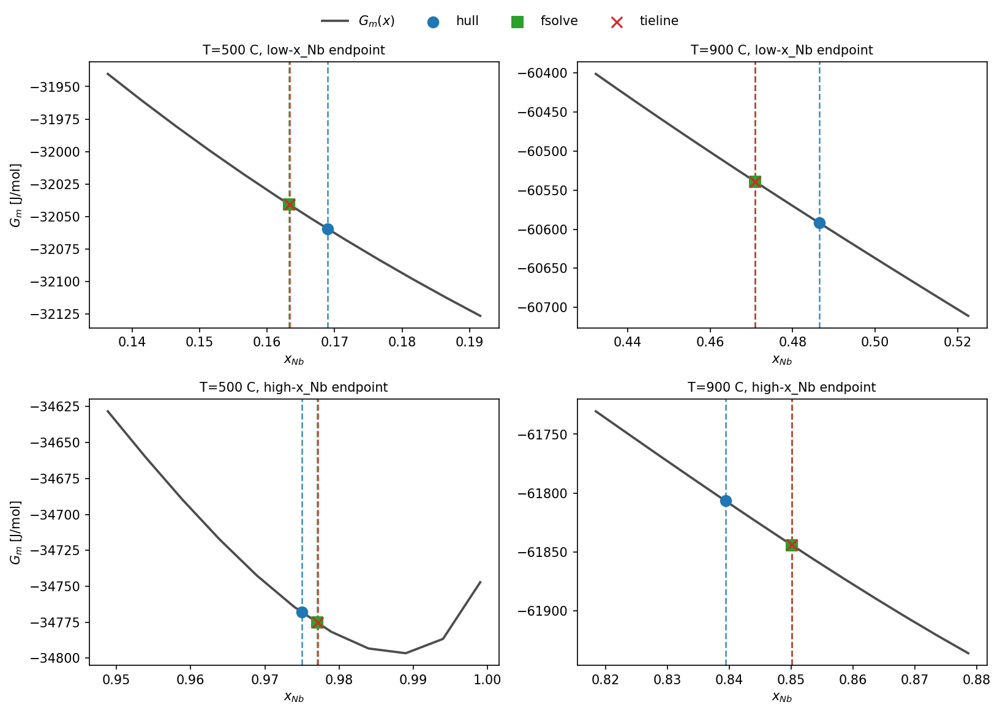

# Tutorial: binary tie-lines (Nb-V) — three methods, one answer?

The [binodal/spinodal tutorial](tutorial_binodal_spinodal_3T.md) computed
the Nb-V binodal at 500 °C, 900 °C, and 1200 °C two different ways —
`method="hull"` and `method="fsolve"` — both operating on the same
tabulated `G_m(x)` data from Step 1. Neither of those calls
`pycalphad.equilibrium()` directly. `pf-tieline` does. Running it at the
same three temperatures turns this into a genuine three-way cross-check
against an independent, more direct computation — and it finds a real,
if small, systematic difference in the method this site uses by default.

## Three methods, one line each

- **`hull`** — lower convex hull of the tabulated `G_m(x)` curve (200
  composition points). The default `binodal_boundary_binary()` method used
  everywhere on this site.
- **`fsolve`** — solves the equal-chemical-potential condition
  (`μ_Nb(x_α) = μ_Nb(x_β)`) on the tabulated `μ(x)` data via
  `scipy.optimize.fsolve`. The legacy method, kept for cross-checking.
- **`pf-tieline`** — calls `pycalphad.equilibrium()` directly on the TDB.
  No tabulated surrogate, no composition grid — the actual CALPHAD solver,
  the same one Step 1 calls once per grid point everywhere else on this
  site.

`hull` and `fsolve` were already compared to each other in the
binodal/spinodal tutorial. `pf-tieline` is the closest thing to ground
truth available here, since it isn't limited by a 200-point composition
grid the way the other two are.

---

## The config — and a real crash

`pf-tieline` needs `simulation.c0` to be a **list**, even for a binary
system:

```yaml
simulation:
  temperature_C: 500
  c0:            [0.50]
```

Every other binary config on this site writes `c0` as a bare scalar
(`c0: 0.50`) — that's what every simulation tutorial uses, and it works
fine for `pf-simulate`. It does not work for `pf-tieline`:

```bash
$ pf-tieline --config configs/nb_v_chem_c50.yaml
...
  File ".../workflows/01c_calphad_tieline/run.py", line 52, in run_tieline
    if len(ind_els) != len(c0):
                       ~~~^^^^
TypeError: object of type 'float' has no len()
```

`configs/nb_v_tieline.yaml` (used below) writes `c0` as `[0.50]`
specifically to avoid this. If you're adapting an existing binary config
for `pf-tieline`, wrap `c0` in a list first.

---

## Running it at three temperatures

`pf-tieline` has no `--set` flag and reads one temperature per run — to
check a different one, edit `simulation.temperature_C` directly (see
[Common gotchas](#common-gotchas)).

```bash
pf-tieline --config configs/nb_v_tieline.yaml
```

```
T        : 500 °C (773.15 K)
c0       : {'NB': 0.5}

=== Raw equilibrium output ===
  BCC_A2  fraction=0.4138
  BCC_A2  fraction=0.5862

2 BCC_A2 phases found (two-phase tie-line).

=== Tie-line endpoints ===
  mat: x_NB=0.9771  x_V=0.0229
  ppt: x_NB=0.1633  x_V=0.8367
```

At 900 °C (`temperature_C: 900` in the same config):

```
=== Tie-line endpoints ===
  mat: x_NB=0.8501  x_V=0.1499
  ppt: x_NB=0.4709  x_V=0.5291
```

At 1200 °C — the temperature the binodal/spinodal tutorial found to be
above this system's critical point (`T_c ≈ 1000 °C`):

```
=== Raw equilibrium output ===
  BCC_A2  fraction=1.0000

WARNING: single-phase equilibrium — alloy is inside the stable region.
Tip: check if the temperature is above the miscibility gap.
```

Exactly the result expected: a single stable phase, no tie-line, no
`c_mat`/`c_ppt` suggestion — `pf-tieline`'s direct equilibrium call agrees
with both tabulated methods on *where* the miscibility gap closes, with no
shared code path between them.

---

## The comparison at 500 °C and 900 °C

| T | Endpoint | `hull` | `fsolve` | `pf-tieline` | hull error | fsolve error |
|---|---|---|---|---|---|---|
| 500 °C | low x_Nb | 0.1690 | 0.1632 | 0.1633 | **3.47%** | 0.03% |
| 500 °C | high x_Nb | 0.9750 | 0.9770 | 0.9771 | 0.21% | 0.005% |
| 900 °C | low x_Nb | 0.4865 | 0.4709 | 0.4709 | **3.30%** | 0.004% |
| 900 °C | high x_Nb | 0.8394 | 0.8501 | 0.8501 | 1.26% | 0.006% |

(Errors are relative to `pf-tieline`, treated here as the reference value.)



`fsolve` and `pf-tieline` land on the same point in every panel above (the
green square and red × overlap). `hull` is visibly, consistently offset —
worst at the low-x_Nb endpoint, where it's off by over 3% at both
temperatures.

**Observation:** `fsolve` agrees with the direct-equilibrium reference to
3-4 significant figures; `hull` disagrees by 1-3.5%, with a consistent
directional bias (it undershoots the low-x_Nb endpoint and overshoots the
high-x_Nb endpoint at 500 °C, pulling the predicted gap narrower than it
actually is).

**Interpretation:** this isn't `hull` being wrong — it's `hull` being
limited by the same 200-point composition grid every Step 1 table on this
site uses. Finding the lower convex hull of a *discretized* curve can't
resolve the true tangent point more precisely than the grid spacing allows
near it, while `fsolve` refines a continuous root on the same underlying
data and `pf-tieline` queries the continuous CALPHAD model directly,
neither limited by that grid.

**This refines a claim made in the binodal/spinodal tutorial's gotchas
table** — that `hull` is "the default/more robust choice." That's still
true in the sense meant there: `hull` can't converge to a spurious root or
get stuck without a good initial guess the way a solver can. But robust
against *failure* and accurate relative to the *true continuous
equilibrium* are different properties, and this tutorial's numbers show a
real, consistent accuracy gap between them — worth knowing if you need the
binodal to better than ~1-3% precision rather than just a reliable,
qualitatively-correct estimate.

---

## Common gotchas

| Symptom | Likely cause |
|---|---|
| `TypeError: object of type 'float' has no len()` | `simulation.c0` is a scalar, not a list — `pf-tieline` requires a list even for binary systems. See [above](#the-config-and-a-real-crash). |
| No way to pass `--set simulation.temperature_C=900` | `pf-tieline` doesn't support `--set` at all (confirmed in its `--help`) — edit the config file's `temperature_C` directly, or keep one config per temperature you care about. |
| `db_path` resolution breaks when the config isn't directly under `configs/` | Same quirk documented in the [tie-line/phase-map tutorial](tutorial_tieline_phase_map.md#common-gotchas) and the [CLI reference](cli_reference.md#pf-tieline-step-1c) — `pf-tieline` resolves `db_path` relative to the config file's own location, not the repo root. |
| "Suggested elastic config update" section is empty | Exactly 1 or exactly 3+ stable phases were found, not exactly 2 — the script only knows how to produce `c_mat`/`c_ppt` text for the two-phase case. Both the single-phase (1200 °C here) and three-phase ([Nb-Hf-V tutorial](tutorial_tieline_phase_map.md)) cases hit this. |

## Where to go next

- **The same cross-check, but the answer is "neither two endpoints is right"** — the [tie-line/phase-map tutorial](tutorial_tieline_phase_map.md) runs this exact comparison for ternary Nb-Hf-V and finds a genuine three-phase equilibrium, not just a numerically-shifted two-phase one.
- **Where the hull/fsolve methods themselves come from** — the [binodal/spinodal tutorial](tutorial_binodal_spinodal_3T.md) is the first stop for the `binodal_boundary_binary()` API these numbers were computed with.
- **Every `pf-*` command in one place** — [CLI Reference](cli_reference.md).
