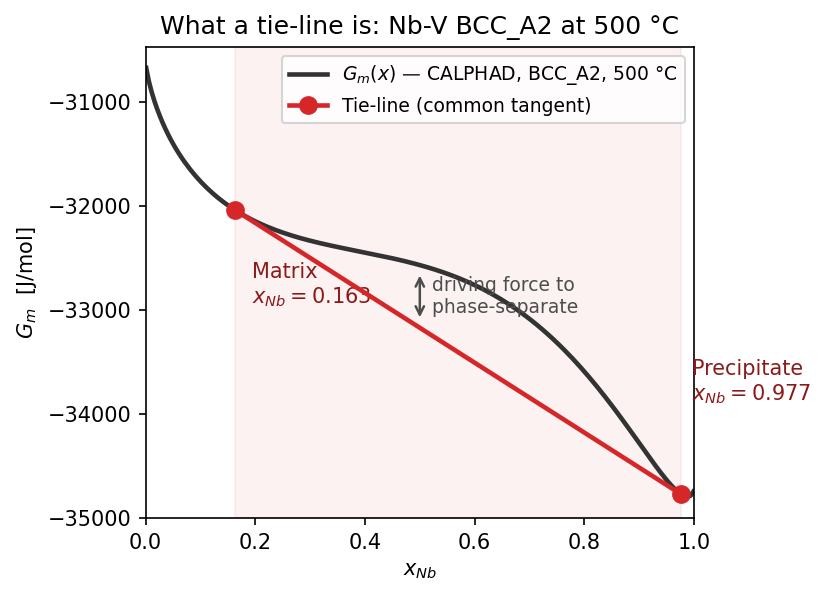

# Tutorial: Binary Tie-Lines (Nb-V) — A Three-Method Comparison

A tie-line is the pair of compositions connected by a common tangent to the
molar Gibbs energy curve: the two phases a homogeneous alloy forms at
equilibrium, defined by the condition that every component's chemical
potential is equal in both phases. In a binary system this is the simplest
possible case — exactly two endpoints and one tangent line, a result that
can be read directly from a `G_m(x)` plot. This simplicity makes the binary
case a suitable setting for validating a tie-line-finding *method* before
applying it to a ternary or quaternary system, where no equivalent visual
check exists.

<figure class="pf-figure" markdown>

<figcaption markdown>**The tie-line, drawn on the real curve.** `pf-tieline`'s result for Nb-V at 500 °C, on the actual CALPHAD `G_m(x)` curve. The red line is the common tangent — touching the curve at the matrix and precipitate compositions, lying on or below it between them. That gap is the driving force to phase-separate.</figcaption>
</figure>

This is confirmed numerically, not only by inspection:
`G_m(x) − tie-line(x) ≥ 0` across the entire two-phase window. That gap is
the thermodynamic driving force for phase separation.

Every binodal boundary reported elsewhere on this site was computed by an
approximate method operating on a finite, tabulated `G_m(x)` grid, rather
than by calling CALPHAD's equilibrium solver directly. This is a reasonable
choice for computational speed, but it is an assumption that should be
checked against an independent, authoritative computation before relying on
the resulting values to better than a rough estimate. That check is the
subject of this tutorial.

The [binodal/spinodal tutorial](tutorial_binodal_spinodal_3T.md) computed
the Nb-V binodal at 500 °C, 900 °C, and 1200 °C two different ways —
`method="hull"` and `method="fsolve"` — both operating on the same
tabulated `G_m(x)` data from Step 1. Neither calls `pycalphad.equilibrium()`
directly; `pf-tieline` does. Running it at the same three temperatures
produces a three-way cross-check against an independent, more direct
computation, and reveals a small but systematic difference in the method
used by default throughout this site.

## Three Methods, Defined

- **`hull`** — the lower convex hull of the tabulated `G_m(x)` curve (200
  composition points). This is the default `binodal_boundary_binary()`
  method used throughout this site.
- **`fsolve`** — solves the equal-chemical-potential condition
  (`μ_Nb(x_α) = μ_Nb(x_β)`) on the tabulated `μ(x)` data via
  `scipy.optimize.fsolve`. Retained as a legacy method for cross-checking.
- **`pf-tieline`** — calls `pycalphad.equilibrium()` directly on the TDB,
  without a tabulated surrogate or composition grid. This is the same
  equilibrium solver Step 1 calls once per grid point everywhere else on
  this site.

`hull` and `fsolve` were already compared to each other in the
binodal/spinodal tutorial. `pf-tieline` provides the closest available
approximation to ground truth here, since its result is not limited by the
200-point composition grid the other two methods share.

---

## Configuration Requirements

`pf-tieline` requires `simulation.c0` to be specified as a **list**, even
for a binary system:

```yaml
simulation:
  temperature_C: 500
  c0:            [0.50]
```

Every other binary config on this site writes `c0` as a bare scalar
(`c0: 0.50`), which is accepted by `pf-simulate` but not by `pf-tieline`:

```bash
$ pf-tieline --config configs/nb_v_chem_c50.yaml
...
  File ".../workflows/01c_calphad_tieline/run.py", line 52, in run_tieline
    if len(ind_els) != len(c0):
                       ~~~^^^^
TypeError: object of type 'float' has no len()
```

`configs/nb_v_tieline.yaml` (used below) writes `c0` as `[0.50]` for this
reason. Any existing binary config adapted for `pf-tieline` requires `c0`
to be wrapped in a list first.

---

## Results at Three Temperatures

`pf-tieline` provides no `--set` flag and reads one temperature per run. A
different temperature requires editing `simulation.temperature_C` directly
(see [Common gotchas](#common-gotchas)).

```bash
pf-tieline --config configs/nb_v_tieline.yaml
```

```
T        : 500 °C (773.15 K)
c0       : {'NB': 0.5}

=== Raw equilibrium output ===
  BCC_A2  fraction=0.4138
  BCC_A2  fraction=0.5862

2 BCC_A2 phases found (two-phase tie-line).

=== Tie-line endpoints ===
  ppt: x_NB=0.9771  x_V=0.0229
  mat: x_NB=0.1633  x_V=0.8367
```

`mat`/`ppt` are assigned by phase fraction, not composition: the larger of
the two fractions above (58.6%) is labeled `mat`, the smaller (41.4%) is
`ppt`. This matters because it does not always correspond to which
endpoint is richer in the reference element — see
[Labeling convention](#labeling-convention-matrix-vs-precipitate) below.

At 900 °C (`temperature_C: 900` in the same config):

```
=== Tie-line endpoints ===
  ppt: x_NB=0.8501  x_V=0.1499
  mat: x_NB=0.4709  x_V=0.5291
```

At 1200 °C — the temperature identified by the binodal/spinodal tutorial as
above this system's critical point (`T_c ≈ 1000 °C`):

```
=== Raw equilibrium output ===
  BCC_A2  fraction=1.0000

WARNING: single-phase equilibrium — alloy is inside the stable region.
Tip: check if the temperature is above the miscibility gap.
```

This is the expected result: a single stable phase, no tie-line, and no
`c_mat`/`c_ppt` suggestion. `pf-tieline`'s direct equilibrium call agrees
with both tabulated methods on the temperature at which the miscibility gap
closes, despite sharing no code path with either.

### Labeling convention: matrix vs. precipitate

`pf-tieline` labels the two endpoints by **phase fraction**, not
composition: the endpoint with the larger equilibrium phase fraction
(the lever-rule weight at the given `c0`) is labeled `mat`; the smaller is
labeled `ppt`. This matches standard usage, in which the matrix is the
majority phase and the precipitate is the minority phase dispersed within
it.

This was not the original behavior. An earlier version of this script
labeled the endpoints by composition instead — the reference-element-poor
endpoint was always `mat`, regardless of which phase actually made up more
of the alloy. At `c0 = 0.5` and 500 °C, that convention and the
fraction-based convention disagree: the composition-poor-in-V endpoint
(`x_Nb = 0.977`) holds only 41.4% of the alloy, while the
richer-in-V endpoint (`x_Nb = 0.163`) holds 58.6%. Labeling by composition
alone called the minority phase `mat`, the opposite of the usual
convention. The fix applied here (`workflows/01c_calphad_tieline/run.py`)
sorts by `fraction` instead, so `mat` is the majority phase at every
composition and temperature, not only the ones where the two conventions
happen to coincide.

---

## Comparison at 500 °C and 900 °C

| T | Endpoint | `hull` | `fsolve` | `pf-tieline` | hull error | fsolve error |
|---|---|---|---|---|---|---|
| 500 °C | low x_Nb | 0.1690 | 0.1632 | 0.1633 | **3.47%** | 0.03% |
| 500 °C | high x_Nb | 0.9750 | 0.9770 | 0.9771 | 0.21% | 0.005% |
| 900 °C | low x_Nb | 0.4865 | 0.4709 | 0.4709 | **3.30%** | 0.004% |
| 900 °C | high x_Nb | 0.8394 | 0.8501 | 0.8501 | 1.26% | 0.006% |

(Errors are computed relative to `pf-tieline`, taken here as the reference
value.)


`fsolve` and `pf-tieline` coincide at every point shown above (the green
square and red × overlap). `hull` is visibly and consistently offset,
most notably at the low-x_Nb endpoint, where the discrepancy exceeds 3% at
both temperatures.

**Observation:** `fsolve` agrees with the direct-equilibrium reference to
3-4 significant figures. `hull` disagrees by 1-3.5%, with a consistent
directional bias — it underestimates the low-x_Nb endpoint and
overestimates the high-x_Nb endpoint at 500 °C, narrowing the predicted
miscibility gap relative to the true value.

**Interpretation:** this discrepancy does not indicate an error in `hull`;
it reflects a limitation inherent to the 200-point composition grid used by
every Step 1 table on this site. The lower convex hull of a *discretized*
curve cannot resolve the true tangent point more precisely than the local
grid spacing permits. `fsolve`, by contrast, refines a continuous root on
the same underlying data, and `pf-tieline` queries the continuous CALPHAD
model directly — neither is constrained by the grid.

**This refines a claim made in the binodal/spinodal tutorial's gotchas
table**, namely that `hull` is "the default/more robust choice." That
claim remains accurate in the sense originally intended: `hull` cannot
converge to a spurious root or stall without a good initial guess, as a
solver can. However, robustness against *failure* and accuracy relative to
the *true continuous equilibrium* are distinct properties. The results
presented here demonstrate a consistent accuracy gap between them, relevant
whenever the binodal is required to better than roughly 1-3% precision
rather than a qualitatively correct estimate.

---

## Common Gotchas

| Symptom | Likely cause |
|---|---|
| `TypeError: object of type 'float' has no len()` | `simulation.c0` is a scalar, not a list — `pf-tieline` requires a list even for binary systems. See [Configuration Requirements](#configuration-requirements). |
| No mechanism for `--set simulation.temperature_C=900` | `pf-tieline` does not support `--set` (confirmed in its `--help` output). The config file's `temperature_C` must be edited directly, or a separate config maintained per temperature of interest. |
| `db_path` resolution fails when the config is not located directly under `configs/` | The same behavior is documented in the [tie-line/phase-map tutorial](tutorial_tieline_phase_map.md#common-gotchas) and the [CLI reference](cli_reference.md#pf-tieline-step-1c) — `pf-tieline` resolves `db_path` relative to the config file's own location, not the repository root. |
| "Suggested elastic config update" section is empty | Exactly one or three-or-more stable phases were found, not exactly two — the script produces `c_mat`/`c_ppt` text only for the two-phase case. Both the single-phase case (1200 °C, above) and the three-phase case (the [Nb-Hf-V tutorial](tutorial_tieline_phase_map.md)) trigger this. |
| `mat` composition looks like the minority phase | `mat`/`ppt` are assigned by phase fraction (majority/minority), not by composition — see [Labeling convention](#labeling-convention-matrix-vs-precipitate). If the result still looks wrong, check `phase_fraction` in the saved `tieline_calphad.yaml` directly rather than inferring it from composition. |

## Related Material

- **The same cross-check for a ternary system, with a different outcome** — the [tie-line/phase-map tutorial](tutorial_tieline_phase_map.md) applies this comparison to Nb-Hf-V and identifies a genuine three-phase equilibrium rather than a numerically shifted two-phase one.
- **The origin of the `hull`/`fsolve` methods** — the [binodal/spinodal tutorial](tutorial_binodal_spinodal_3T.md) introduces the `binodal_boundary_binary()` API used to compute these values.
- **Complete command reference** — [CLI Reference](cli_reference.md).
