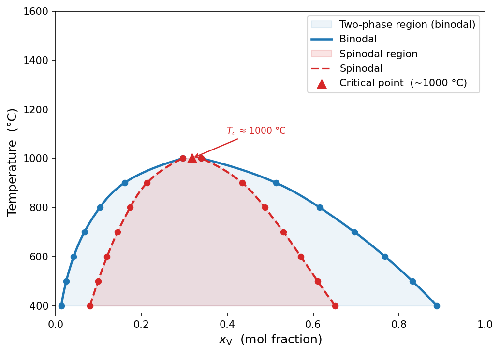
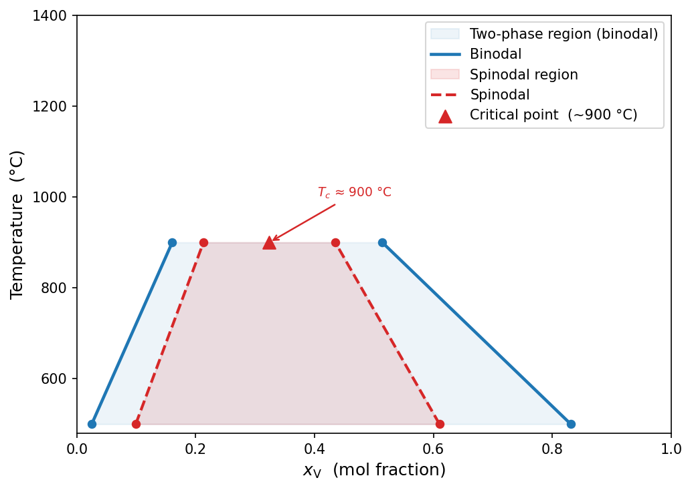
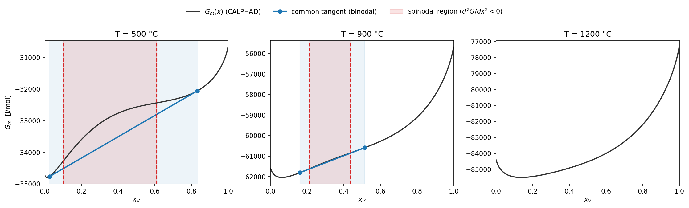

# Tutorial: binodal vs. spinodal boundaries at three temperatures (binary Nb-V)

This tutorial is thermodynamics-only — no phase-field simulation (Step 3) is
run. It computes and compares the **binodal** (equilibrium two-phase/solvus
boundary) and **spinodal** (local-instability boundary) for Nb-V BCC_A2 at
three temperatures chosen to show qualitatively different regimes: deep
inside the miscibility gap, near the critical point, and above it. Every
number and figure below came from an actual run on this machine.

## The physical distinction

For a binary system, the molar Gibbs energy curve `G_m(x)` at a fixed
temperature defines two different boundaries, and it's easy to conflate them:

- **Binodal** (equilibrium/solvus boundary): the two compositions connected
  by a **common tangent line** to `G_m(x)`. A homogeneous alloy between these
  two compositions can lower its total free energy by separating into two
  phases at exactly these two compositions — this is the thermodynamic
  equilibrium condition (equal chemical potentials in both phases).
- **Spinodal** (instability boundary): the two compositions where
  `d²G_m/dx² = 0` — i.e. where the curve's local curvature changes sign.
  Between them, `d²G_m/dx² < 0`: the homogeneous alloy is *locally*
  unstable to infinitesimal composition fluctuations, with no nucleation
  barrier. This is the boundary that actually matters for the phase-field
  tutorials ([binary](tutorial_2d_binary.md), [ternary](tutorial_2d_ternary_elastic.md)) — spinodal decomposition only happens inside it.

The spinodal region is always nested **inside** the binodal region (binodal
⊇ spinodal), and the two coincide at the critical temperature `T_c`, where
the two-phase gap closes entirely. All three facts show up directly in the
numbers below.

---

## The config file

Full contents of `configs/nb_v_binodal_spinodal_3T.yaml`:

```yaml
system:
  name:              nb_v
  db_path:           data/tdb/HfNbTiV_BCC_PhaseForge_v2_Tdep.tdb
  elements:          [NB, V]
  phase:             BCC_A2
  reference_element: V

thermo:
  composition_ranges:
    NB: [0.001, 0.999]
  n_points:          200
  temperatures_C:    [500, 900, 1200]   # deep in gap / near T_c / above T_c

simulation:
  temperature_C: 500

output:
  data_dir:      data/HfNbTiV_BCC_PhaseForge_v2/NbV
  results_dir:   results/HfNbTiV_BCC_PhaseForge_v2/NbV
  run_name:      binodal_spinodal_3T
```

This reuses the same `data_dir` as the [2D binary tutorial](tutorial_2d_binary.md)
(same TDB, same system) — see that tutorial's
[path-resolution explainer](tutorial_2d_binary.md#the-config-file) for how
`db_path`/`data_dir`/`results_dir` resolve relative to the repo root
regardless of your working directory.

**Why the `simulation:` block is this short:** the other tutorials' configs
carry a full phase-field parameter set (`N`, `kappa`, `M`, `dt`, `n_steps`,
...) because Step 3 actually integrates the PDE. This config never calls
Step 3, and Steps 1-2 only ever read one key out of `simulation:` —
`temperature_C`, used purely as an output-folder label
(`workflows/02_fit_surrogate/run.py:76,83`). Everything else in a typical
`simulation:` block is simply unused here.

The one thing to watch: `output.run_name` is set to an explicit string
(`binodal_spinodal_3T`) rather than `auto`. `auto` triggers
`build_run_name()` (`src/phasefoundry/config.py:126`), which *does* read
`simulation.c0`, `simulation.kappa`, and `simulation.M` to build a
descriptive filename — so leaving `run_name: auto` with a trimmed
`simulation:` block would raise a `KeyError`. Set `run_name` explicitly (as
here) for any config that skips Step 3 entirely.

---

## Step 1 — generate thermodynamic tables

```bash
pf-generate --config configs/nb_v_binodal_spinodal_3T.yaml
```

### The mathematics: what "equilibrium" means at each of the 198 points

It's worth being precise here, because the word "equilibrium" is doing two
different jobs in this tutorial and it's easy to conflate them: Step 1 calls
`pycalphad` to solve a *constrained single-phase* equilibrium at each
composition grid point; the binodal/spinodal boundaries in Step 2 are a
*separate*, downstream calculation done entirely by PhaseFoundry on the
resulting `G_m(x)` curve, not by `pycalphad` directly.

**What's actually solved, per grid point.** For a fixed temperature `T` and
a fixed nominal overall composition `x = (x_Nb, x_V)` with `x_Nb + x_V = 1`
(only `x_Nb` is passed as a condition — `x_V` is implied), `pycalphad`
minimizes the BCC_A2 phase's own Gibbs energy model over its *internal*
degrees of freedom `y` (sublattice site fractions — the variables a CALPHAD
Compound Energy Formalism model is actually written in terms of), subject
to the constraint that those internal site fractions reproduce the imposed
overall composition `x`:

```
G_m(x, T)  =  min_y  G^BCC_A2(T, y)        subject to:
                                             Σ_k y_s^k = 1   for every sublattice s
                                             (site fractions y consistent with x)
```

`G^BCC_A2(T, y)` itself is whatever Compound-Energy-Formalism expression is
assessed in the TDB — in the usual CALPHAD form, a reference term (weighted
sum of the pure-element endpoint energies), an ideal configurational-entropy
term (`+RT·Σ_s a_s Σ_k y_s^k ln y_s^k`), and an excess/interaction term
(typically a Redlich-Kister polynomial in the site fractions). The exact
assessed parameters live in `data/tdb/HfNbTiV_BCC_PhaseForge_v2_Tdep.tdb`,
not in PhaseFoundry — `pycalphad` reads and minimizes that model; PhaseFoundry
never sees the CEF parameters directly.

**The one detail that makes this whole tutorial possible:** the call in
`src/phasefoundry/thermodynamics/generate.py` restricts the `Workspace` to a
*single* phase (`phases=[phase]`, i.e. just `BCC_A2`) and wraps it in
`IsolatedPhase`, which forces `pycalphad` to stay on that one phase's free
energy surface. This is **not** the usual multi-phase CALPHAD equilibrium
(no lever rule, no phase fractions, no checking whether some other phase is
actually more stable at that `x`). If it *were* a full multi-phase
equilibrium, then for any `x` inside the two-phase gap `pycalphad` would
already report the phase-split, lever-rule-averaged result — and `G_m(x)`
would already be piecewise-linear across the gap, with the common-tangent
points already baked in. There would be nothing left for Step 2's
`binodal_boundary_binary()`/`spinodal_boundary_binary()` to compute.

`IsolatedPhase` instead returns the Gibbs energy of the **metastable,
homogeneous, single-phase state** — "if the whole system were forced to stay
as one BCC_A2 solid solution at this exact composition, what would its
energy be?" — smoothly, across the *entire* composition range, including
deep inside the real two-phase region. That's exactly the curve the common
tangent/convex-hull construction in [the section above](#the-construction-explicitly-three-temperatures-side-by-side)
needs as its input. Steps 1 and 2 are therefore doing genuinely different
jobs: Step 1 answers "what's the energy of this phase, forced to be
homogeneous, at each composition?"; Step 2 answers "given that whole curve,
where would the real system actually prefer to split into two phases?"

**Why `μ` and the Hessian come out "for free."** Each grid point's
`IsolatedPhase` call also evaluates `MU(el)` and `MU(el).X(el)` —
`pycalphad`'s *exact analytic* derivatives of that same constrained
minimization, not finite differences on the tabulated `G_m` values. Since
`μ_A = ∂G_m/∂x_A` by definition, this gives `∂²G_m/∂x_A² = ∂μ_A/∂x_A`
directly — these are the **Jansson derivatives** referenced throughout this
project (see the [binary tutorial's equation section](tutorial_2d_binary.md#the-equation-being-solved)),
and `spinodal_boundary_binary()` uses exactly this stored `∂μ/∂x` to find
where it crosses zero, rather than differencing the `G_m` curve numerically.

With that established: this is why Step 1's progress bar runs to exactly
198 — one independent constrained minimization per composition grid point,
embarrassingly parallel across points (hence
`ProcessPoolExecutor` in `generate.py`), repeated once per temperature.

On a cold cache (no `nb_v_bcc_a2_{500,900,1200}C.h5` yet), this actually
computes 198 `pycalphad` equilibria per temperature:

```
Grid: 198 valid points, 2 elements
  NB: [0.0050, 0.9950]  mean=0.5000
  V: [0.0050, 0.9950]  mean=0.5000
Computing thermodynamics: 100%|██████████| 198/198 [00:06<00:00, 30.5pt/s]
Saved 198 points to .../nb_v_bcc_a2_500C.h5
   500.0 °C  →  saved nb_v_bcc_a2_500C.h5
  ... (repeats for 900 °C and 1200 °C)

Done. 3 tables in .../data/HfNbTiV_BCC_PhaseForge_v2/NbV
```

!!! note "~23 s total (~7 s/temperature at ~30 equilibria/s) on this machine"
    Run Step 1 again and you'll instead see `exists, skipping` for all
    three — it only (re)computes a temperature if its HDF5 file isn't
    already in `data_dir`. If you're following along on a fresh clone,
    you'll see the full computed output above; if you've already run the
    other Nb-V tutorials first, you'll see `skipping`, since this
    `data_dir` is shared across every Nb-V v2 tutorial/config.

## Step 2 — fit the surrogate and compute both boundaries

```bash
pf-surrogate --config configs/nb_v_binodal_spinodal_3T.yaml
```

```
Found 9 temperature table(s).
  Fitting G_m spline surrogate ...
T = 673.1 K (400.0 °C)  |  Gm spline built on 200 pts  x_V=[0.0010, 0.9990]
T = 773.1 K (500.0 °C)  |  Gm spline built on 200 pts  x_V=[0.0010, 0.9990]
  ...
T = 1673.2 K (1400.0 °C) |  Gm spline built on 200 pts  x_V=[0.0010, 0.9990]
  Computing spinodal/binodal boundaries ...
Saved figure to .../phase_diagram.png
Saved figure to .../GM_all.png
Saved figure to .../500C/thermodynamics/spinodal.png
```

**Worth noticing:** this says `Found 9 temperature table(s)`, not 3. Step 2
globs *every* `nb_v_bcc_a2_*C.h5` file already sitting in `data_dir` — not
just the three temperatures listed in this config's `thermo.temperatures_C`
(that list only controls what Step 1 *ensures exists*). Since this
`data_dir` is shared with other Nb-V tutorials/configs, tables already
existed at 400, 600, 700, 800, 1000, and 1400 °C too, so the resulting
phase diagram below is actually built from all 9 — a nicer result than the
3 we asked for, not a bug. If you want a phase diagram built from *only*
your configured temperatures, point `data_dir` at an empty directory
instead.



This is the real output — binodal (blue) and spinodal (red) domes for Nb-V
BCC_A2, with the critical point located at **T_c ≈ 1000 °C**. Notice the
spinodal dome sits strictly inside the binodal dome at every temperature
below `T_c`, and both envelopes converge to the same point at `T_c` — both
are direct consequences of the two boundaries' definitions above, not
something imposed by the plotting code.

### What you'd actually get from only 3 points

The figure above benefits from 9 cached temperatures, not the 3 this
config asks for. So: what does the dome look like built from **only**
500, 900, and 1200 °C — i.e. deleting the other 6 cached tables first?



This is real output too, from the same two functions, given only those
three table paths. Two things go wrong, and both matter:

1. **It's not a smooth dome.** `plot_phase_diagram()` fits a spline through
   whatever temperatures have a valid boundary, with spline order
   `k = min(3, n_valid_points - 1)`. 1200 °C has no boundary (it's above
   `T_c`), so only 500 °C and 900 °C remain — two points, `k = 1`, i.e. a
   **straight line** between them in each direction. The flat top at 900 °C
   isn't the dome's apex; it's just the highest temperature that happened
   to still be inside the gap.
2. **The estimated critical point is wrong, not just imprecise.** The
   critical-point marker lands at `T_c ≈ 900 °C` here, a full 100 °C below
   the `T_c ≈ 1000 °C` the 9-temperature version actually resolves — this
   plot has no way to know the true apex is between 900 and 1200 °C, since
   it never sampled anything in that interval.

So: yes — **more than 3 points are required**, and specifically, you need
temperature coverage that actually brackets `T_c` closely on both sides,
not just "a point below it, a point near it, and a point above it." The
first phase-diagram figure only looked good because 6 extra temperatures
(400, 600, 700, 800, 1000, 1400 °C) happened to already be cached in this
shared `data_dir` from earlier work — this config's own 3 temperatures,
run in isolation, would not have produced it.

---

## The construction, explicitly: three temperatures side by side

The figure above is convenient but hides *how* each point was computed. This
one makes it explicit — `G_m(x)` at each of our three chosen temperatures,
with the common tangent (binodal) and the `d²G/dx² = 0` crossings (spinodal)
drawn directly on the curve:



Numeric boundaries (x_V), read directly off these constructions:

| T | Binodal (x_V) | Spinodal (x_V) | Regime |
|---|---|---|---|
| 500 °C | [0.025, 0.831] | [0.099, 0.610] | deep inside the two-phase gap |
| 900 °C | [0.161, 0.514] | [0.213, 0.435] | close to T_c — both envelopes narrow sharply |
| 1200 °C | — (none) | — (none) | above T_c — `G_m(x)` is globally convex, single phase stable everywhere |

At 1200 °C, `G_m(x)` (rightmost panel) has a single minimum and positive
curvature everywhere — there's no common tangent to draw and no sign change
in `d²G/dx²`, which is exactly what "above the critical temperature" means
physically, not a numerical failure.

### How this is actually computed (Python API)

The CLI runs this for you, but this is the exact call — useful if you want
boundaries at temperatures other than your `thermo.temperatures_C` list, or
want to script a boundary sweep yourself:

```python
from pathlib import Path
from phasefoundry.thermodynamics.spinodal import (
    spinodal_boundary_binary, binodal_boundary_binary,
)

data_dir = Path("data/HfNbTiV_BCC_PhaseForge_v2/NbV")
temps = [500.0, 900.0, 1200.0]
paths = [data_dir / f"nb_v_bcc_a2_{int(t)}C.h5" for t in temps]

spinodal = spinodal_boundary_binary(paths, "NB", temperatures_celsius=temps,
                                     reference_element="V")

# method="hull": lower convex hull of G_m(x) — the common-tangent
# construction, geometrically. No initial guess needed, can't converge to a
# spurious root. method="fsolve" is the legacy equal-chemical-potential
# solver, kept for cross-checking.
binodal = binodal_boundary_binary(paths, "NB", temperatures_celsius=temps,
                                   method="hull", spinodal_data=spinodal)
```

`spinodal_data=spinodal` is passed into `binodal_boundary_binary()` as a
fallback: very close to `T_c` the two-phase gap can be too narrow for either
boundary-finding method to resolve reliably, and since binodal ⊇ spinodal
always holds, falling back to the (numerically better-behaved) spinodal
result in that regime is more defensible than returning nothing.

---

## Interpreting the result

**Observations** (directly from the numbers above):

- Both the binodal and spinodal composition windows narrow monotonically as
  T increases from 500 → 900 °C.
- At 1200 °C, neither boundary exists — `G_m(x)` is convex over the entire
  composition range.
- The spinodal window is strictly narrower than the binodal window at both
  500 °C and 900 °C, consistent with binodal ⊇ spinodal.

**Interpretation:** these three temperatures bracket a critical temperature
for this TDB's Nb-V BCC_A2 assessment at `T_c ≈ 1000 °C` (read directly off
the phase-diagram figure, where the binodal and spinodal curves meet). This
is a property of the specific CALPHAD database being queried
(`HfNbTiV_BCC_PhaseForge_v2_Tdep.tdb`), not a universal fact about Nb-V —
a different assessment could place `T_c` elsewhere.

---

## Common gotchas

| Symptom | Likely cause |
|---|---|
| `binodal_boundary_binary()` / `spinodal_boundary_binary()` return `None` for a temperature | Expected above `T_c` — `G_m(x)` has no two-phase region there, not a bug. Check against the phase-diagram figure before assuming something's broken. |
| Phase diagram shows more temperatures than your config lists | `data_dir` is shared and Step 2 globs everything cached there (see the Step 2 note above) — use a dedicated empty `data_dir` if you want it limited to exactly your configured temperatures. |
| Binodal and spinodal boundaries look identical very close to `T_c` | Expected — they coincide exactly at `T_c`, so near it the two methods can legitimately agree to within numerical tolerance. |
| `method="hull"` and `method="fsolve"` disagree noticeably | `"fsolve"` depends on hardcoded initial guesses and can miss a root the hull method finds (or vice versa, rarely); `"hull"` is the default/more robust choice for exactly this reason — cross-check with `"fsolve"` only if you have a specific reason to distrust the hull result. |
| Dome looks flat-topped / trapezoidal, or the critical-point marker looks too low | Too few temperatures with a valid boundary — `plot_phase_diagram()`'s spline order is `k = min(3, n_valid - 1)`, so 2 valid points gives a straight line, not a dome. Add more temperatures, concentrated near where you expect `T_c` (see the 3-point-only comparison above). |

## Where to go next

- **See the spinodal region actually decompose** — the [2D binary tutorial](tutorial_2d_binary.md) runs a full Cahn-Hilliard simulation at 500 °C, inside the spinodal window computed here.
- **The eigenvalue API underneath `d²G/dx²=0`** — the [Hessian stability analysis tutorial](tutorial_hessian_stability_binary.md) covers `GmInterpolant.d2g()`/`.min_eigenvalue()` directly, validated against finite differences, and connects the eigenvalue at your `c0` to the solver's `δ`, `λ*`, and `dt_stable`.
- **Ternary boundaries** — for 2+ independent fields there's no single `d²G/dx²=0` crossing; the [ternary tutorial](tutorial_2d_ternary_elastic.md)'s Step 2 spinodal map instead scans the composition simplex and tests the sign of the Hessian's minimum eigenvalue at each point (`GmInterpolant.min_eigenvalue()`), and `compute_ternary_phase_regions()` in `src/phasefoundry/thermodynamics/spinodal.py` provides a related region-classification approach for ternary systems.
- **Recommended phase-field parameters from this curvature** — `recommend_pfm_params()` in the same module takes the `G_m` spline fit (not the boundary dicts above) and derives suggested `kappa`/`dt`/`Lx`/`N` starting points for Step 3 directly from `d²G/dx²` at your chosen `c0`.
