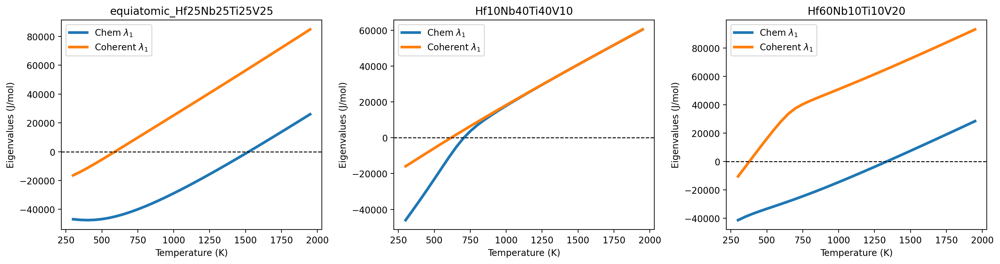

# Tutorial: Coherent-Hessian Stability Analysis (Quaternary Hf-Nb-Ti-V)

The [binary Hessian stability tutorial](tutorial_hessian_stability_binary.md)
covers `N_ind = 1`, where the Hessian is a bare scalar, and leaves the
coherency (elastic) correction out entirely. This tutorial covers both
extensions at once, for the quaternary Hf-Nb-Ti-V system used throughout the
manuscript's Section 3.4: a genuine `N_ind = 3` Hessian, plus the classical
isotropic (Cahn, *Acta Metall.* 9 (1961) 795) coherency correction added on
top of it. By the end you will have built the calculation by hand, piece by
piece, then run the same thing as a one-command, config-driven workflow.

No new config file is required for the step-by-step part below; it only
reads two files already on disk: `data/tdb/HfNbTiV_BCC_PhaseForge_v2_Tdep.tdb`
and `data/HfNbTiV_BCC_PhaseForge_v2/sqs_elastic_constants_HfNbVTi-orb-v2.csv`.

---

## Step 1 — the chemical Hessian

`chemical_hessian()` evaluates the Gibbs-Duhem-reduced Hessian
`H_ij = d(mu_i - mu_ref)/dx_j` at one composition and temperature, via
pycalphad's Jansson derivatives — the same quantity the
[binary tutorial](tutorial_hessian_stability_binary.md#the-hessian-api-and-what-it-reduces-to-for-binary)
introduces, just a genuine 3×3 matrix here instead of a 1×1 one (independent
elements Hf, Nb, Ti; V is the reference).

```python
from phasefoundry.thermodynamics.coherent_hessian import chemical_hessian

comp = {"HF": 0.25, "NB": 0.25, "TI": 0.25}   # equiatomic
H_chem = chemical_hessian(
    db_path="data/tdb/HfNbTiV_BCC_PhaseForge_v2_Tdep.tdb",
    elements=["HF", "NB", "TI", "V"],
    phase="BCC_A2",
    composition=comp,
    temperature_K=773.15,                      # 500 C
    reference_element="V",
)
```

```
array([[-38709.4, -17265.5, -22225.9],
       [-17265.5,   3582.7,  -1897.2],
       [-22225.9,  -1897.2,  17867.1]])
```

This matrix alone already has a negative eigenvalue (checked in
[Step 5](#step-5-gauge-invariant-eigenvalues) below) — the purely chemical
free energy predicts this alloy is spinodally unstable at 500°C. Coherency
is what might change that conclusion.

## Step 2 — the elastic inputs

The eigenstrain and modulus come from the SQS/MLIP elastic-constants CSV,
through `phasefoundry.elasticity.sqs_interpolant` — the same interpolation
code `workflows/01b_lookup_elastic` uses for every simulation's eigenstrain.

```python
from pathlib import Path
from phasefoundry.elasticity.sqs_interpolant import (
    load_and_filter, build_interpolators, query_composition,
)

csv_path = Path("data/HfNbTiV_BCC_PhaseForge_v2/sqs_elastic_constants_HfNbVTi-orb-v2.csv")
df = load_and_filter(csv_path, ["HF", "NB", "TI", "V"])
interps = build_interpolators(df, ["HF", "NB", "TI"])
props = query_composition(interps, comp, ["HF", "NB", "TI"])
```

```
props["a_relaxed_A"]           # 3.2918   (lattice parameter, angstrom)
props["biaxial_modulus_M_GPa"] # 144.5950
```

## Step 3 — the Vegard eigenstrain coefficients

`eta_k = (1/a) * da/dx_k`, one per independent element, via central finite
difference on the interpolated lattice parameter — same method as the
alpha-coefficients computed inside `workflows/01b_lookup_elastic`, just
callable directly at a single composition here.

```python
from phasefoundry.elasticity.sqs_interpolant import vegard_eta_coefficients

eta = vegard_eta_coefficients(interps, comp, ["HF", "NB", "TI"])
```

```
{'HF': 0.1455, 'NB': 0.0734, 'TI': 0.0608}
```

Hf's coefficient is roughly twice Nb's or Ti's — Hf has by far the biggest
effect on the lattice parameter of the three.

## Step 4 — the isotropic coherency correction

```python
from phasefoundry.thermodynamics.coherent_hessian import isotropic_coherent_correction

correction = isotropic_coherent_correction(
    eta, props["biaxial_modulus_M_GPa"] * 1e9, props["a_relaxed_A"],
    independent_elements=["HF", "NB", "TI"],
)
```

```
array([[65744.2, 33181.6, 27483.9],
       [33181.6, 16747. , 13871.3],
       [27483.9, 13871.3, 11489.4]])
```

This is `2 * V_m * M * (eta ⊗ eta)` — a rank-1 matrix built purely from the
outer product of `eta` with itself, scaled by the modulus and molar volume.
Every entry is positive (it has to be: it's `M` times a vector outer
product with itself), so adding it to `H_chem` can only push eigenvalues
*up*, toward stability — that's the physical content of "coherency
penalizes decomposition."

```python
H_coh = H_chem + correction
```

```
array([[27034.8, 15916.1,  5258. ],
       [15916.1, 20329.7, 11974.1],
       [ 5258. , 11974.1, 29356.5]])
```

## Step 5 — gauge-invariant eigenvalues

Raw eigenvalues of `H_chem`/`H_coh` would depend on the arbitrary choice of
V as the reference element. `hessian_eigenvalues()` projects through the
orthogonal matrix `KADIRVEL_HF_NB_TI_O` (Table 1, Kadirvel et al., *Scripta
Materialia* 212 (2022) 114521) first, so the result doesn't:

```python
from phasefoundry.thermodynamics.coherent_hessian import (
    hessian_eigenvalues, KADIRVEL_HF_NB_TI_O,
)

hessian_eigenvalues(H_chem, KADIRVEL_HF_NB_TI_O)
hessian_eigenvalues(H_coh, KADIRVEL_HF_NB_TI_O)
```

```
array([-39095.6,  13585.2,  41009.5])   # chemical: smallest eigenvalue negative -> unstable
array([ 11214. ,  23819.8,  46899.5])   # coherent: all positive -> stable
```

**Reading the result:** the chemical-only Hessian has one negative
eigenvalue (−39,095.6 J/mol) — unstable. Adding the coherency correction
pushes every eigenvalue positive, smallest now +11,214 J/mol — stable. At
exactly this composition and temperature, the isotropic coherency
correction is large enough to flip the stability conclusion.

All five steps above are also available as the one convenience call
`evaluate_coherent_stability(...)`, which returns a dict with every
intermediate quantity (`chemical_hessian`, `coherent_hessian`, `eta`,
`M_GPa`, `a_ref_A`, and both eigenvalue arrays) — useful once you already
know what each piece means and just want the numbers.

---

## Running the full temperature sweep as a workflow

Steps 1–5 are one composition, one temperature. The config-driven workflow
repeats them over a temperature range and over several compositions in one
command, writing results to disk instead of a Python session:

```bash
python workflows/01e_coherent_hessian/run.py \
    --config configs/hf_nb_ti_v_coherent_hessian.yaml
```

```
  System:   HF - NB - TI - V  (ref: V)
  TDB:      .../data/tdb/HfNbTiV_BCC_PhaseForge_v2_Tdep.tdb
  Elastic:  sqs_elastic_constants_HfNbVTi-orb-v2.csv
  T sweep:  300-1950 K, step 50 K (34 points)
  Projection: kadirvel_hf_nb_ti
  Compositions: 3

  --- equiatomic_Hf25Nb25Ti25V25: {'HF': 0.25, 'NB': 0.25, 'TI': 0.25} ---
    a_ref = 3.2918 A   M = 144.5950 GPa
    eta_HF = 0.145488
    eta_NB = 0.073429
    eta_TI = 0.060820
    Written: .../coherent_hessian_fig4_reproduction/eigenvalues_equiatomic_Hf25Nb25Ti25V25.csv

  --- Hf10Nb40Ti40V10: {'HF': 0.1, 'NB': 0.4, 'TI': 0.4} ---
    a_ref = 3.2879 A   M = 129.0303 GPa
    eta_HF = 0.170015
    eta_NB = 0.085021
    eta_TI = 0.066252
    Written: .../coherent_hessian_fig4_reproduction/eigenvalues_Hf10Nb40Ti40V10.csv

  --- Hf60Nb10Ti10V20: {'HF': 0.6, 'NB': 0.1, 'TI': 0.1} ---
    a_ref = 3.4009 A   M = 150.3315 GPa
    eta_HF = 0.139535
    eta_NB = 0.086307
    eta_TI = 0.053103
    Written: .../coherent_hessian_fig4_reproduction/eigenvalues_Hf60Nb10Ti10V20.csv

  Written: .../coherent_hessian_fig4_reproduction/fig_04_eigenvalues.png
  Written: .../coherent_hessian_fig4_reproduction/fig_04_eigenvalues.pdf
  Written: .../coherent_hessian_fig4_reproduction/provenance.yaml
```



Three files land in `results/HfNbTiV_BCC_PhaseForge_v2/NbHfTiV/coherent_hessian_fig4_reproduction/`
per composition and overall:

- `eigenvalues_<label>.csv` — the full eigenvalue sweep (all three
  eigenvalues at every temperature, not just `λ_min` — enough to reproduce
  Figure 4's second-eigenvalue panel too), e.g.:

  | temperature_K | chem_eig_1 | coh_eig_1 |
  |---|---|---|
  | 300.0 | −46,877.4 | −16,411.5 |
  | 750.0 | −39,990.2 | 9,788.9 |
  | 900.0 | −33,662.1 | 19,027.8 |

- `fig_04_eigenvalues.png`/`.pdf` — a 3-panel plot, one per composition,
  chemical and coherent `λ_1` vs. temperature.
- `provenance.yaml` — the exact `a_ref`/`M`/`eta` used per composition, so
  reproducing a specific number later doesn't mean re-deriving it.

---

## What checking this against the manuscript's Figure 4 revealed

The calculation above isn't hypothetical — it is the same calculation
behind the manuscript's Figure 4, redone from files that are actually
tracked in this repository. The original figure was produced by
`notebooks/stability_analysis_nonisotropic.ipynb`, which queries a TDB
named `HfNbVTi.tdb` and reads eta/M from a CSV named
`sqs_elastic_constants_HfNbVTi.csv` — neither exists anywhere in this repo;
the notebook's own comment says those values were "pulled from excel
sheet." Repeating Steps 1–5 above with the production files, instead of
those two untraceable ones, changes the answer:

| Inputs | λ_min(chemical) | λ_min(coherent) |
|---|---|---|
| Original notebook (untraceable TDB + CSV) | — | positive (reviewer's reading of the published figure) |
| Production TDB, original notebook's η/M | −39,096 J/mol | −18,786 J/mol (negative) |
| Production TDB **and** production η/M (Steps 1–5 above) | −39,096 J/mol | **+11,214 J/mol (positive)** |

Swapping only the TDB flips the sign one way; also correcting η/M (η_Hf
turns out to be 69% larger from the production data than the notebook's
hand-transcribed value — see Step 3) flips it back. The fully
production-consistent calculation reproduces the reviewer's reading of the
published figure, so the apparent contradiction with Fig. 7(b)'s observed
decomposition is **not** a data-provenance artifact — the real explanation
has to come from the modeling gap described next.

---

## Limitations: what this does not settle

A positive `λ_min(H^coh)` at one composition only rules out spontaneous,
barrierless decomposition from that exact point, under the isotropic
approximation used in Step 4. It does not, by itself, explain why
Fig. 7(b)'s finite-amplitude, anisotropic, spatially-resolved phase-field
simulation decomposes anyway. Three candidate explanations remain open, in
roughly decreasing order of how directly testable they are with code
already in this repo:

1. **Isotropic vs. anisotropic elasticity** — Step 4 uses one scalar
   modulus `M`. The real solver's `C_ijkl(x)` is strongly anisotropic at
   this composition (`A_Z = 1.52`); the isotropic worst-case estimate here
   may simply be too stabilizing.
2. **Fixed point vs. composition-dependent field** — `eta` and `M` are
   evaluated once, at exactly the mean composition (Steps 2–3). The real
   simulation starts from finite-amplitude noise and re-evaluates
   composition-dependent elastic properties pointwise as the field evolves.
3. **Local vs. global stability** — a positive `λ_min` rules out linear
   (spinodal) decomposition, not a lower-energy two-phase state reached via
   nucleation past a finite barrier, which discretized noise over a long
   (700,000 s) simulation can still seed.

None of these is resolved by the calculation in this tutorial; testing them
would mean evaluating the anisotropic correction along multiple modulation
directions instead of the isotropic worst case, or tracking local stability
along the real matrix/precipitate composition trajectory rather than only
at the symmetric starting point — natural follow-on work for this module.

---

## Where this leads

- **The `N_ind = 1` case, without coherency** — the
  [binary Hessian stability tutorial](tutorial_hessian_stability_binary.md)
  this one extends.
- **The full anisotropic elasticity the Step 4 correction approximates** —
  the [2D ternary elasto-chemical tutorial](tutorial_2d_ternary_elastic.md).
- **The SQS/MLIP elastic-constants interpolation Steps 2–3 use** —
  `src/phasefoundry/elasticity/sqs_interpolant.py`, also used by
  `workflows/01b_lookup_elastic` for every simulation's eigenstrain.
