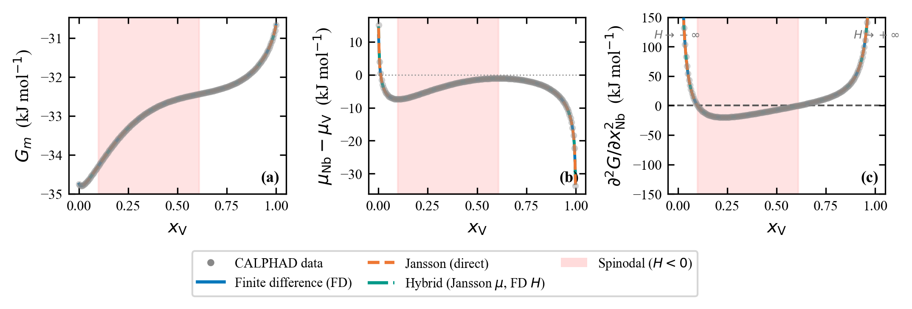
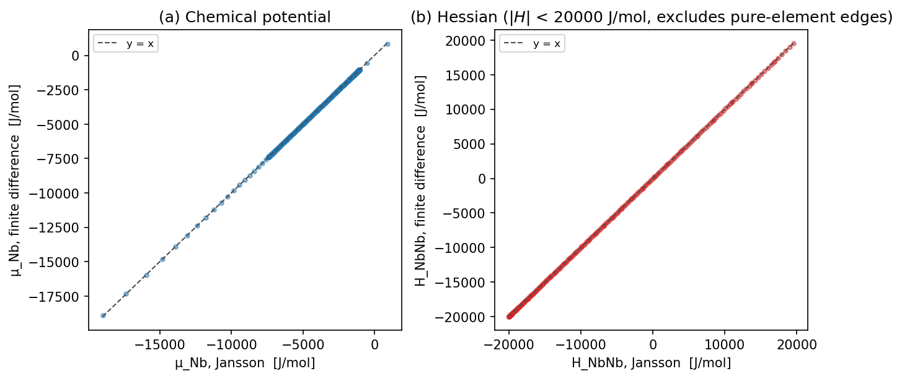
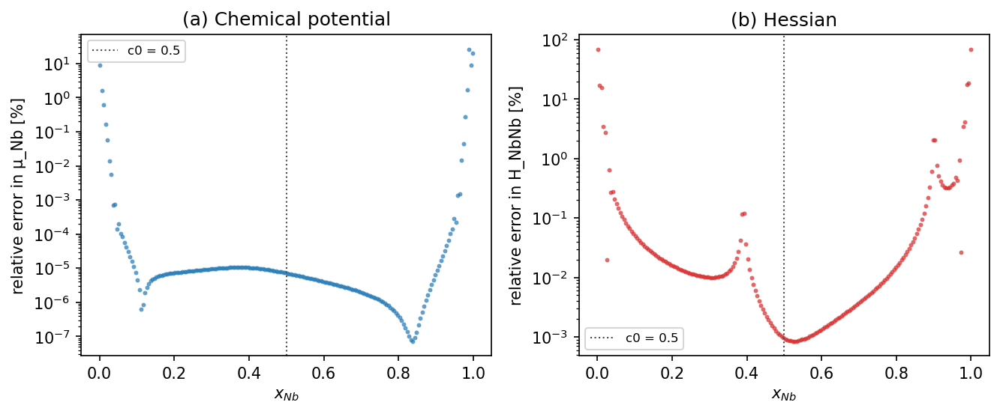
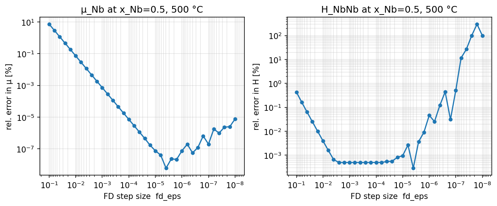

# Tutorial: validating derivatives against finite differences (binary Nb-V)

Every result on this site depends on two derivatives of the molar Gibbs
energy: the chemical potential \(\mu_i = \partial G_m/\partial x_i\) and the
Hessian \(H_{ij} = \partial^2 G_m/\partial x_i \partial x_j\). They set the
driving force and stability criterion
for every spinodal boundary, every solver stabilization constant, and every
interface-width estimate used elsewhere on this site. This page validates
the two ways PhaseFoundry computes them — analytic (Jansson) derivatives
and finite differences — against each other directly, explains the
numerical-analysis reasoning behind where and why they agree or disagree,
and demonstrates why the obvious way to visualize that comparison (overlay
the two curves) usually fails, and what to use instead.

---

## Mathematical foundation

### What is being compared

For the binary system used throughout this page (Nb-V, BCC_A2), `x_Nb` is
the single independent composition variable. Two quantities are computed
two different ways:

$$
\mu_{Nb}(x) = \frac{\partial G_m}{\partial x_{Nb}}
\qquad
H_{NbNb}(x) = \frac{\partial^2 G_m}{\partial x_{Nb}^2}
$$

### Why H has one entry, not four

A binary composition has two mole fractions, `x_Nb` and `x_V`, but only one
of them is independent — the constraint `x_Nb + x_V = 1` removes a degree
of freedom. PhaseFoundry makes this explicit by designating `V` the
*reference* (dependent) element throughout this page's configs
(`reference_element: "V"`), leaving a single independent field, `x_Nb`
(`N_ind = 1`). `GmInterpolant.d2g()` does not compute a raw, unconstrained
`∂²G_m/∂x_Nb∂x_V`; it computes the Gibbs-Duhem-reduced form directly,
exactly as documented in `interpolant.py`:

$$
H_{NbNb} = \frac{\partial \mathrm{MU}_{Nb}}{\partial x_{Nb}} - \frac{\partial \mathrm{MU}_{V}}{\partial x_{Nb}}
$$

where \(\mathrm{MU}_{Nb}\) and \(\mathrm{MU}_{V}\) are `pycalphad`'s raw
per-element chemical potentials at equilibrium (not the Gibbs-Duhem-reduced
\(\mu_{Nb} = \mathrm{MU}_{Nb} - \mathrm{MU}_{V}\) defined above). This
single scalar is already the complete, physically meaningful Hessian for
this system, not one entry of an unreported 2×2 matrix — the other three
entries a naive unconstrained treatment might suggest are not independent
information; they are already folded into this term by the constraint
itself. A genuine multi-entry Hessian, with real off-diagonal terms,
appears only once a system has two or more independent composition fields
(ternary and above) — see the
[Hessian stability tutorial's note on `N_ind ≥ 2`](tutorial_hessian_stability_binary.md#the-hessian-api-and-what-it-reduces-to-for-binary)
for where that extra structure actually starts to matter.

### Method 1: Jansson derivatives

`derivative_method="jansson"` evaluates `μ` and `H` via `pycalphad`'s exact
analytic derivatives of the underlying Compound Energy Formalism model —
obtained by implicit differentiation of the equilibrium (Gibbs-energy
minimization) condition with respect to the system-level composition
variables, propagated through the sublattice site-fraction degrees of
freedom at the solved equilibrium point. This technique is named for B.
Jansson's 1984 doctoral thesis at KTH (*Computer Analysis of Phase
Diagrams*), which introduced it for CALPHAD assessment software, and is
standard practice in modern CALPHAD tools. Courtney Kunselman and
coauthors describe this class of analytically differentiable
phase-stability metrics, including the chemical-potential and Hessian
derivatives used throughout this page, in
[*Analytically differentiable metrics for phase stability*](https://www.sciencedirect.com/science/article/abs/pii/S0364591624000476)
(*Calphad* 86, 102705, 2024). No composition perturbation or re-solving of
the equilibrium is required — each derivative is evaluated exactly, at the
composition requested, from the same calculation that produced `G_m`
itself.

### Method 2: finite differences

`derivative_method="fd"` instead differences the tabulated `G_m(x)` values
produced by Step 1, using the formulas implemented in
`src/phasefoundry/thermodynamics/interpolant.py`:

$$
\mu_i = \frac{G_m(x+\epsilon\,\hat e_i) - G_m(x-\epsilon\,\hat e_i)}{2\epsilon}
\qquad \text{(central difference)}
$$

$$
H_{ii} = \frac{G_m(x+\epsilon\,\hat e_i) - 2\,G_m(x) + G_m(x-\epsilon\,\hat e_i)}{\epsilon^2}
\qquad \text{(central second difference)}
$$

$$
H_{ij} = \frac{G_m(x+\epsilon\hat e_i+\epsilon\hat e_j) - G_m(x+\epsilon\hat e_i-\epsilon\hat e_j)
             - G_m(x-\epsilon\hat e_i+\epsilon\hat e_j) + G_m(x-\epsilon\hat e_i-\epsilon\hat e_j)}{4\epsilon^2}
\qquad \text{(mixed partial, } i \neq j\text{, ternary and above)}
$$

with step size \(\epsilon\) set by `fd_eps` (default `1e-4`). For the binary
case used here, only the \(H_{ii}\) formula applies — there is no second
independent field for a mixed partial to involve.

### Why these do not agree exactly

Central finite differences carry two competing error sources, and this is
true for any finite-difference scheme, not specific to this codebase:

- **Truncation error**, from the Taylor-series terms the finite-difference
  stencil does not capture, which shrinks as \(\epsilon \to 0\) (as
  \(O(\epsilon^2)\) for the central-difference formulas above).
- **Floating-point cancellation error**, from subtracting two nearly equal
  floating-point numbers, which *grows* as \(\epsilon \to 0\) (as
  \(O(\epsilon_{\text{machine}}/\epsilon)\)), since the numerator's relative
  precision degrades as the two evaluated points move closer together.

These two effects push in opposite directions as \(\epsilon\) changes, producing a
U-shaped total-error curve with a minimum at some intermediate step size —
demonstrated directly, below.

---

## Running the validation

```bash
pf-validate --config configs/nb_v_chem_c50.yaml
```

```
Residuals computed over x_NB in [0.0010, 0.9990] (200 raw CALPHAD grid points, 500 °C)

Method      median |Δμ|/|μ|       P90       max   median |ΔH|/|H|       P90       max
fd                 0.0000%   0.0002%  26.3703%           0.0128%   0.3844%  69.5787%
jansson            0.0000%   0.0000%   0.0000%           0.0000%   0.0000%   0.0000%
hybrid             0.0000%   0.0000%   0.0000%           0.0128%   0.3844%  69.5787%

For reference, absolute RMSE over this same full range (dominated by divergence near the pure-element edges — the median/P90 figures above are the representative accuracy numbers, not these):
Method          RMSE G_m        RMSE μ        RMSE H  J/mol
fd                   0.0         302.3      442218.8
jansson              0.0           0.0           0.0
hybrid               0.0           0.0      442218.8
```



This is the default `pf-validate` figure, and it demonstrates a common
problem in validating near-identical numerical methods: the three curves
are visually indistinguishable in every panel, including the Hessian
panel, despite the legacy RMSE_H value above being in the tens of millions
of J/mol. The overlay plot cannot show what that number reports, because
the disagreement (examined in detail below) is concentrated in a narrow
composition region the eye cannot resolve at this scale.

!!! note "Why pf-validate reports median/P90/max relative error, not just RMSE"
    The legacy RMSE table is still printed (for continuity), but it is no
    longer the headline number, because three factors combine to make a
    single RMSE value a poor summary here — none of them indicate a defect
    in either derivative method:

    1. **RMSE is taken over the entire composition sweep** (200 points,
       `x_NB` from `0.0010` to `0.9990`, printed explicitly above so the
       range is never ambiguous), not over the narrower interior region
       any actual simulation on this site uses.
    2. **`H` itself diverges near the pure-element edges.** The ideal
       configurational-entropy term in the CALPHAD model
       (`RT · Σ y ln y`) has a second derivative that grows without bound
       as `x → 0` or `x → 1`. A central finite difference's truncation
       error grows fastest exactly where the function being differenced
       is changing fastest — so the small *relative* disagreement between
       Jansson and FD becomes a large *absolute* disagreement right at
       the edges, where `H` is already large in magnitude. At the true
       grid edges used above (`x_NB = 0.0010`, `0.9990`), this pushes the
       single worst-point relative error in `H` to **69.58%** — still
       large, but genuine (see the note below on a separate issue that,
       until fixed, made this figure far worse than that).
    3. **RMSE squares every pointwise error before averaging.** A handful
       of edge points with absolute differences of thousands to hundreds
       of thousands of J/mol dominate the mean once squared, even though
       the overwhelming majority of the 200 points agree to 4-6
       significant figures and contribute almost nothing to the sum.

    The **median** and **90th-percentile** relative error solve this
    without needing to choose an arbitrary composition cutoff: a statistic
    that ignores a small minority of outlier points is, by construction,
    insensitive to exactly how divergent those outliers are or exactly how
    close to `x = 0`/`1` the grid happens to sample. `H`'s median relative
    error above, `0.0128%`, and even its 90th percentile, `0.3844%`, both
    describe the interior accuracy correctly — consistent with the direct
    figure-level measurement at `x_Nb = 0.5` worked through below
    (`0.000144%`) — while the **max**, `69.58%`, remains a real but
    unrepresentative single-point artifact, included only for completeness.
    This is the same finding the
    [Hessian stability tutorial's warning box](tutorial_hessian_stability_binary.md#validating-against-finite-differences)
    states directly: a naive full-range error summary is misleading taken
    at face value, not incorrect.

!!! success "A real bug, found through this analysis and fixed: central differencing exactly at a grid boundary"
    The max relative error in `H` at the true grid edge used to read
    **4877.99%**, not 69.58% — nearly 70× worse than the number above. The
    gap was not numerical-analysis texture; it was a genuine bug in
    `GmInterpolant`, diagnosed directly from this investigation and since
    fixed.

    `GmInterpolant._eval_flat()` clips every composition query to
    `grid_bounds` before evaluating the `G_m` spline, specifically to
    prevent extrapolation past the training data. At `x_NB = 0.0010` (the
    exact lower edge of the 200-point grid), the central-difference
    stencil needs `G_m(x - ε)`, which — being below the grid's minimum —
    was silently clipped to `G_m(x)`, identical to the stencil's own
    center point. The formula

    $$
    H(x) = \frac{G_m(x+\epsilon) - 2\,G_m(x) + G_m(x-\epsilon)}{\epsilon^2}
    $$

    degenerated into `(G_m(x+ε) − G_m(x)) / ε²` — not a valid second-
    derivative estimate at all, since one of its three required points had
    silently collapsed onto another. The fix: `GmInterpolant.mu()`/`.d2g()`
    now detect, per composition point, whether a central stencil would
    cross `grid_bounds`, and switch to a matched 2nd-order one-sided
    (forward or backward) stencil there instead — the standard remedy for
    numerical differentiation at a domain boundary, which does not need
    any point outside the training data's support. The off-diagonal
    (mixed-partial) case, relevant for ternary-and-above systems near a
    simplex vertex, is handled the same way per independent dimension.

    | | `H` at `x_NB = 0.0010` (J/mol) | rel. error vs. Jansson |
    |---|---|---|
    | Jansson (exact) | 6,412,034.81 | — |
    | FD, before the fix (clipped) | -306,366,173.25 | 4877.99% |
    | FD, after the fix (one-sided) | 1,994,537.55 | 68.89% |

    The remaining 68.89% is the genuine effect described in point 2 above
    — real curvature the model has at that composition, which no finite-
    difference scheme can fully capture working from a tabulated grid.
    Switching to a one-sided stencil does not eliminate that; it only
    removes the artifact that was making it look roughly 70× worse than
    it actually is.

---

## A better representation: parity plots

Plotting one method's value directly against the other's, point by point,
instead of both against composition, removes the shared x-axis that
causes the overlay problem:



Every point lies almost exactly on the `y = x` reference line — the same
near-exact agreement the raw overlay showed, but now with a geometry that
would make any real deviation visible as a point lifting off the diagonal,
rather than two curves separating by a few pixels. For this particular
comparison, even the parity plot does not show the discrepancy at normal
scale (panel (b) also excludes the most extreme pure-element-edge points,
where `|H|` exceeds 20,000 J/mol, purely so the near-interior data remains
legible). A parity plot is the right tool when the two methods are
expected to disagree by an amount visible at normal axis scale; it is not,
by itself, sufficient when the disagreement is confined to a small
fraction of the range and is small in absolute terms even there — the
case here, and the reason a third representation is needed.

## The representation that actually works: relative error vs. composition, log scale

```python
import numpy as np

x = np.linspace(0.01, 0.99, 300).reshape(1, -1)
mu_rel_err = np.abs(interp_fd.mu(x) - interp_j.mu(x)) / np.abs(interp_j.mu(x)) * 100
H_rel_err  = np.abs(interp_fd.d2g(x)[0, 0] - interp_j.d2g(x)[0, 0]) / np.abs(interp_j.d2g(x)[0, 0]) * 100
```



This is the figure that actually shows what the RMSE table reported. Both
panels share the same shape: a broad, flat region of extremely small
disagreement (10⁻⁴–10⁻⁵%, limited only by floating-point precision) across
most of the composition range, rising sharply to several percent — and, at
the very edge, double digits — as `x_Nb → 0` or `x_Nb → 1`.

Points are plotted individually rather than connected by a line, because
each of the 300 points is an independent evaluation, and connecting them
would draw a continuous curve implying structure that is not actually
there. The visible fine-grained ripple within the flat interior region is
real but not meaningful on its own: `GmInterpolant` fits a separate cubic
spline to each of `G_m(x)` (used by FD) and the raw `MU`/`dMU` columns
(used by Jansson), and a cubic spline's third derivative — which sets the
local truncation error of a central difference — is only piecewise
constant, jumping at every one of the 200 raw composition grid points.
The ripple's spacing tracks that raw grid spacing directly; it is a
property of comparing two independently-fit splines at sub-grid
resolution, not a sign of a problem with either derivative method.

**Numeric summary at the composition used throughout this site's binary
tutorials (`c0 = 0.5`):** 0.000007% for `μ`, 0.000144% for `H` — six-figure
agreement, consistent with the RMSE table's `jansson` row reading exactly
`0.0` (rounding) relative to itself and the small `fd` RMSE values being
driven entirely by the edge region. **Maximum disagreement observed**
(`x_Nb ∈ [0.01, 0.99]`): 8.1% for `μ` at `x_Nb = 0.99`, 17.1% for `H` at
`x_Nb = 0.987`.

The cause of the edge disagreement is the same effect documented in the
[Hessian stability tutorial](tutorial_hessian_stability_binary.md#where-the-disagreement-actually-occurs):
the ideal configurational-entropy term in the CALPHAD model diverges as
`x → 0` or `1`, and a finite difference's truncation error grows precisely
where the function being differenced is diverging most steeply — a genuine
accuracy limitation of finite differences in that region, not a flaw in
either implementation.

---

## Step-size sensitivity

The `fd_eps` step size is a free parameter, and the truncation-vs-cancellation
trade-off described above means there is an optimal value, not a
"smaller is always better" relationship. Sweeping `fd_eps` from
\(10^{-1}\) to \(10^{-8}\) at `x_Nb = 0.5`, 500 °C, and comparing each
resulting FD value against the (step-size-independent) Jansson value:



Both panels show the predicted U-shape: error decreases as \(\epsilon\)
shrinks from \(10^{-1}\), reaches a minimum near \(\epsilon \approx
4\times10^{-6}\), and increases again as \(\epsilon\) shrinks further and
floating-point cancellation dominates. The minimum achievable error is far
smaller for `μ` (~\(10^{-7}\)%, a first derivative via a single central
difference) than for `H` (~\(3\times10^{-4}\)%, a second derivative,
which amplifies cancellation error further) — expected, since each
additional order of differentiation degrades the achievable floating-point
precision.

The default `fd_eps = 1e-4` sits on the truncation-error-dominated side of
the minimum, not exactly at it, but close enough that the resulting error
(0.000007% for `μ`, 0.000497% for `H`, at `x_Nb = 0.5`) is already far
below any scale that matters for this site's tutorials. A smaller default
would reduce truncation error further at this composition, at the cost of
being closer to the cancellation-dominated regime for compositions or
temperatures where `G_m` is smoother (smaller second derivatives), where
the optimal \(\epsilon\) shifts. `1e-4` is a reasonable general-purpose default
precisely because it avoids being too close to either failure mode across
a range of conditions, not because it is optimal at any single point.

---

## General principles

Three lessons from this comparison generalize beyond this specific pair of
methods:

1. **An overlay plot of two curves expected to agree closely is not
   evidence they agree closely** — it is only evidence the disagreement is
   smaller than the plot's resolution can show, which is a much weaker
   claim. A quantitative figure (relative error, or a parity plot with
   enough dynamic range) is required to actually support a numeric
   agreement claim.
2. **Parity plots and log-scale relative-error plots answer different
   questions.** A parity plot shows whether a relationship is linear and
   unbiased — useful when deviations are large enough to be visible at
   normal scale. A log-scale relative-error plot shows *how small* the
   disagreement is and *where it stops being small* — necessary when the
   two methods agree to several significant figures almost everywhere, as
   here.
3. **Finite-difference step size has an optimum, not a monotonic
   best-direction.** Reporting or assuming "finite differences disagree
   with the analytic result because the step size was too large" is only
   half correct — too small a step size produces the same failure mode
   from the opposite direction. Any claim about finite-difference accuracy
   should state or justify the step size used.
4. **A mean-squared summary statistic (RMSE) is a poor default whenever a
   small minority of points can diverge.** It is not uniquely a
   finite-difference problem — any aggregate error metric computed over a
   domain containing a genuine mathematical singularity will be dominated
   by however close the sampling grid happens to approach it, independent
   of how well-behaved the function is everywhere else. Median and
   percentile statistics are insensitive to this without requiring an
   arbitrary cutoff to exclude the problematic region; `pf-validate`
   reports both, as shown above.
5. **A central-difference stencil evaluated exactly at a domain boundary
   needs a point outside the domain, and silently clamping that point
   corrupts the result rather than just losing accuracy.** The standard
   remedy is a matched one-sided (forward/backward) stencil of the same
   accuracy order, switched in automatically within one step size of a
   boundary — not a weaker approximation, a differently-shaped one. This
   is a general numerical-differentiation rule, not specific to CALPHAD
   or to this codebase; see the box above for the real bug this produced
   here and its fix.

---

## Common gotchas

| Symptom | Likely cause |
|---|---|
| Two near-identical curves plotted together show no visible difference despite a large reported error metric | Expected when the disagreement is confined to a small fraction of the domain — see the [relative-error section](#the-representation-that-actually-works-relative-error-vs-composition-log-scale) above. Check a relative-error or parity representation before concluding the error metric is wrong. |
| `pf-validate`'s legacy RMSE_H value looks alarmingly large | Expected — it is computed over the full composition range, including the pure-element edges where `H` itself diverges. Use the median/P90 relative error reported above it instead, which `pf-validate` now prints by default; see the [Hessian stability tutorial](tutorial_hessian_stability_binary.md#validating-against-finite-differences) for the same finding worked through in detail. |
| `pf-validate`'s **max** relative error (printed next to median/P90) is tens of percent at the exact grid edges | Expected — see the note under [Running the validation](#running-the-validation) above. This is the genuine, remaining curvature effect after the boundary-clipping bug described there was fixed; it is a real single-point artifact, not evidence the median/P90 figures are wrong. |
| Reducing `fd_eps` makes finite-difference results *less* accurate | Past the optimal step size, floating-point cancellation error dominates over truncation error — see the [step-size sensitivity](#step-size-sensitivity) section above. |
| `H_ij` (off-diagonal) formula needed for a ternary/quaternary system | Shown in [Mathematical foundation](#mathematical-foundation) above; exercised directly in the [Hessian stability tutorial](tutorial_hessian_stability_binary.md)'s discussion of `GmInterpolant.d2g()` for `N_ind ≥ 2`. Near a simplex vertex, each independent dimension switches to a one-sided stencil independently — see the boundary-bug note under [Running the validation](#running-the-validation). |

## Related material

- **Where these same numbers feed the solver** — the [Hessian stability analysis tutorial](tutorial_hessian_stability_binary.md) traces `λ_min`, `δ`, `λ*`, and `dt_stable` back to this same Hessian.
- **The same validation question for boundary-finding, not derivatives** — the [binary tie-line tutorial](tutorial_binary_tieline.md) applies the same parity/zoomed-comparison approach to comparing `hull`, `fsolve`, and `pf-tieline` for the binodal boundary itself.
- **Running this for a different system or temperature** — [CLI Reference](cli_reference.md#pf-validate-step-5-optional) for `pf-validate`'s full options.
