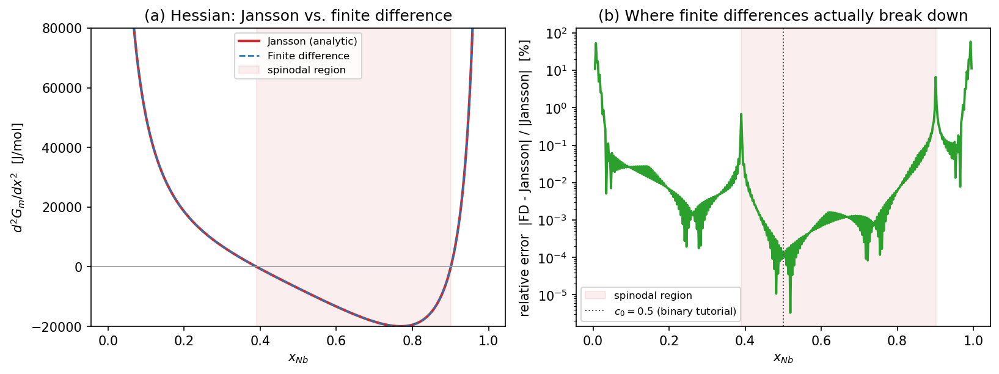

# Tutorial: Hessian stability analysis (binary Nb-V)

Every tutorial on this site has used the Gibbs-energy Hessian without
explaining the machinery behind it: the [binodal/spinodal tutorial](tutorial_binodal_spinodal_3T.md)
found *where* `d²G_m/dx² = 0`, and the [2D binary tutorial](tutorial_2d_binary.md)'s
Step 3 printed `H_NBNB`, `λ_min`, `δ`, `λ*`, and `dt_stable` without deriving
any of them. This tutorial provides that derivation — the actual API
(`GmInterpolant.d2g()` / `.min_eigenvalue()`), validated against finite
differences, with every number traced back to where it was already
presented. No new config file is required; everything below reuses
`configs/nb_v_chem_c50.yaml` and the Nb-V v2 thermodynamic tables already on
disk from the earlier tutorials.

---

## The Hessian API, and what it reduces to for binary

`src/phasefoundry/thermodynamics/interpolant.py` implements the Hessian
generally, for any number of independent components:

```python
def d2g(self, c):
    """Hᵢⱼ = ∂²G/∂cᵢ∂cⱼ, shape (N_ind, N_ind, *spatial)"""
    ...

def min_eigenvalue(self, c):
    """
    Minimum eigenvalue of the Hessian at each spatial point.
    Negative → spinodally unstable.
    """
    H = self.d2g(c)                      # (N_ind, N_ind, *spatial)
    ...
    lmin = np.linalg.eigvalsh(H[:, :, k]).min()   # per point
    ...
```

For a binary system there is only one independent composition field
(`N_ind = 1`), so `d2g()` returns a **1×1 matrix** at every point — its only
"eigenvalue" is that single entry, `d²G_m/dx²`. The eigen-decomposition
machinery performs no nontrivial work yet for `N_ind = 1`; only once two or
more independent fields are present (ternary and beyond) does
`min_eigenvalue()` extract the worst direction out of a genuine matrix
rather than reporting a scalar. This is deliberate: the same function call
operates unchanged for binary, ternary, or quaternary systems — this
tutorial establishes what it computes using the simplest case, where every
number can be verified by hand.

---

## Reproducing a previously reported number

```python
from pathlib import Path
from phasefoundry.thermodynamics.interpolant import build_interpolant

paths = [Path("data/HfNbTiV_BCC_PhaseForge_v2/NbV/nb_v_bcc_a2_500C.h5")]
interp = build_interpolant(paths, ["NB", "V"], "V", temperature_K=773.15,
                            derivative_method="jansson")

interp.min_eigenvalue([[0.5]])   # x_Nb = 0.5, the binary tutorial's c0
```

```
-7239.28
```

This is the exact number the [2D binary tutorial](tutorial_2d_binary.md#step-3-run-the-simulation)
printed as `H_NBNB (diagonal) = -7.239e+03 J/mol` and
`λ_min (spinodal) λ_min = -7.239e+03 J/mol (UNSTABLE)` — not a coincidence;
the same `GmInterpolant` machinery computes both. Negative indicates
instability, consistent with x_Nb = 0.5 sitting well inside the spinodal
window `[0.390, 0.901]` found in the binodal/spinodal tutorial.

---

## Validating against finite differences

```bash
pf-validate --config configs/nb_v_chem_c50.yaml
```

```
Residuals computed over x_NB in [0.0010, 0.9990] (200 raw CALPHAD grid points, 500 °C)

Method      median |Δμ|/|μ|       P90       max   median |ΔH|/|H|       P90       max
fd                 0.0000%   0.0002%  26.3703%           0.0128%   0.3844%  69.5787%
jansson            0.0000%   0.0000%   0.0000%           0.0000%   0.0000%   0.0000%
hybrid             0.0000%   0.0000%   0.0000%           0.0128%   0.3844%  69.5787%

For reference, absolute RMSE over this same full range (dominated by divergence near the pure-element edges — the median/P90 figures above are the representative accuracy numbers, not these):
Method          RMSE G_m        RMSE μ        RMSE H  J/mol
fd                   0.0         302.3      442218.8
jansson              0.0           0.0           0.0
hybrid               0.0           0.0      442218.8
```

!!! warning "The legacy RMSE_H figure appears alarming. It is misleading, not incorrect."
    442,218.8 J/mol suggests finite differences are badly broken. They
    are not — in the region that actually matters, they agree with the
    analytic (Jansson) Hessian to **4 significant figures**, consistent
    with the `0.0128%` median relative error `pf-validate` now reports
    above it. The RMSE is computed over the *entire* composition range
    (200 points, x_V ∈ [0.001, 0.999], printed explicitly above), and is
    dominated almost entirely by a handful of points near the
    pure-element edges, examined below — the same reason the **max**
    relative error above reaches a much larger `69.58%` at the single
    worst edge point, without that number being any more representative
    of typical accuracy than the RMSE is. (This RMSE used to read 23.8
    million and the max 4877.99% — a genuine central-differencing bug at
    the grid boundary, found through this investigation and fixed; see
    the [derivative validation tutorial](tutorial_derivative_validation.md#running-the-validation)
    for the full story and the fix.) See that same page for the full
    reasoning behind reporting median/P90 instead of RMSE.


This is `pf-validate`'s own figure. Visually, the three derivative methods
are indistinguishable in all three panels, including panel (c), the
Hessian — which is precisely why the large RMSE value is surprising at
first.

### Where the disagreement actually occurs

```python
import numpy as np

x = np.linspace(0.005, 0.995, 400)
Hj  = interp.d2g(x.reshape(1, -1))[0, 0]               # Jansson
Hfd = build_interpolant(paths, ["NB","V"], "V", 773.15,
                         derivative_method="fd").d2g(x.reshape(1, -1))[0, 0]
rel_err = np.abs(Hfd - Hj) / np.abs(Hj) * 100
```



| x_Nb | Jansson H (J/mol) | FD H (J/mol) | Relative error |
|---|---|---|---|
| 0.500 (binary tutorial's c0) | -7160.8 | -7160.8 | 0.0001% |
| 0.099 (spinodal edge) | 50497.3 | 50509.7 | 0.025% |
| 0.050 | 114333.4 | 114403.7 | 0.062% |
| 0.020 | 300973.2 | 308698.4 | 2.57% |
| 0.390 (spinodal boundary, H≈0) | 15.7 | 15.8 | 0.68% |
| 0.901 (spinodal boundary, H≈0) | -185.3 | -172.9 | 6.70% |

Two **distinct** effects are responsible, and conflating them would be
incorrect:

1. **Near the pure-element limits (x_Nb → 0 or → 1), the disagreement is
   real and grows large in both absolute and relative terms** (2.6% by
   x_Nb = 0.02, tens of percent closer to the edge). This reflects the
   ideal configurational-entropy term in the CALPHAD model
   (`RT·Σ y ln y`, discussed in the
   [binodal/spinodal tutorial's mathematics section](tutorial_binodal_spinodal_3T.md#the-mathematics-what-equilibrium-means-at-each-of-the-198-points))
   — its second derivative diverges as `x → 0`, and a finite central
   difference's truncation error grows precisely where the function being
   differenced diverges. This is also the region the degenerate mobility
   `M(c) = M̊·c·(1-c)` (from the
   [binary tutorial's equation section](tutorial_2d_binary.md#the-equation-being-solved))
   is designed to suppress — the two features of the codebase address the
   same underlying issue from different directions.
2. **At the spinodal boundary crossings (x_Nb ≈ 0.390, 0.901), the large
   *relative* error is an artifact, not a genuine disagreement.** H ≈ 0
   there by definition (that is what "boundary" means), so dividing a
   small, numerically noisy absolute difference (~0.1-12 J/mol) by a small
   denominator produces a misleadingly large percentage. The *absolute*
   agreement remains excellent.

Only the first effect is a genuine accuracy limitation of finite
differences; the second is relative error behaving poorly near a zero
crossing, as it would for any two numerically close methods. In the region
any of this site's configs actually simulate — `c0` chosen well inside the
spinodal window, away from the pure-element corners — Jansson and FD agree
to 4-5 significant figures, and `derivative_method: jansson` is used
throughout mainly to avoid the FD step-size tuning problem and the cost of
2-4 extra `G_m` evaluations per point, not because FD is unusable in this
region.

---

## From eigenvalue to solver parameters

Step 3's diagnostics (`sim_params.txt`) derive several numbers directly
from this same Hessian — but not always at the same composition. Two
distinct evaluations are involved, and the distinction matters
(`src/phasefoundry/phasefield/solver.py`):

**At exactly `c0`** (`_print_sim_summary`, around line 1040) — the Hessian
is evaluated once, at the mean composition, and its most-negative
eigenvalue `λ_min` feeds:

```
δ       = sqrt(κ / |λ_min|)                     interface width
λ*      = 4π · sqrt(κ / |λ_min|)                most-unstable wavelength
λ_c     = 2π · sqrt(2κ / |λ_min|)               critical wavelength
```

With κ = 1×10⁻¹² J·m²/mol and λ_min = -7239.28 J/mol:
`δ = sqrt(1e-12/7239.28) = 1.175×10⁻⁸ m` — exactly the `δ_NB = 1.175e-08 m`
printed in the binary tutorial.

**Over a scan window around `c0`** (`stable_dt()`, `src/phasefoundry/phasefield/solver.py:194`) —
`dt_stable` instead uses the *largest* `|eigenvalue|` found anywhere in a
composition window of ±0.3 around `c0` (a 20-point coarse scan), not the
value at `c0` itself:

```python
dt_stable = safety * dx**2 / (M_max * eig_max)
```

```python
>>> from phasefoundry.phasefield.solver import stable_dt
>>> stable_dt(M_diag=[5e-21], dx=1e-6/128, interpolant=interp, c0=[0.5])
0.18325325038772003
```

This matches the binary tutorial's `dt_stable = 1.8325e-01 s` exactly. The
window-scanned `|eigenvalue|` that actually set this value is **19983.9
J/mol** — almost 3× larger than `|λ_min(c0)| = 7239.3 J/mol` — because the
scan reaches compositions closer to the spinodal edge, where the curvature
is steeper, even though the simulation's actual mean composition is at the
much gentler x_Nb = 0.5. This is a more conservative (safer) estimate than
using `λ_min(c0)` alone would provide.

!!! note "A small, confirmed inconsistency"
    `sim_params.txt` prints this line as `Stable dt (safety=0.4) dt_stable=
    ...` — but `stable_dt()` is called without an explicit `safety`
    argument (`solver.py:484`), so it actually uses the function's own
    default, `safety=0.3` (`solver.py:200`), which is what the `0.18325`
    value above was computed with. The `"(safety=0.4)"` in the printed
    label does not match the value actually used — a small, pre-existing
    documentation/display inconsistency, not a correctness error in the
    stability calculation itself.

---

## A practical API note

`min_eigenvalue()` returns a bare Python `float` only when the input
composition is truly 0-dimensional. Passing anything with an explicit
spatial axis — including a single point such as `[[0.5]]` — returns a
NumPy array instead:

```python
>>> interp.min_eigenvalue([[0.5]])
array([-7239.28])          # NOT a bare float
>>> float(interp.min_eigenvalue([[0.5]])[0])
-7239.28                   # the scalar value
```

This is worth knowing before writing `if interp.min_eigenvalue(c) < 0:`,
which produces an array-truthiness error rather than the intended
comparison.

---

## Where this leads

For `N_ind = 1`, the Hessian's "eigenvector" is trivial — only one
composition direction exists, so instability always points along it. This
ceases to hold at `N_ind = 2` (ternary): the Hessian becomes a genuine 2×2
matrix, and its eigenvector indicates *which combination* of composition
fluctuations is most unstable, not merely whether one exists. This is the
natural extension of this tutorial, using the same Nb-Hf-V system as the
[ternary elasto-chemical tutorial](tutorial_2d_ternary_elastic.md), and is
the origin of the anisotropic raft orientation seen in that tutorial's
final microstructure.

- **This Hessian defining the spinodal boundary** — the [binodal/spinodal tutorial](tutorial_binodal_spinodal_3T.md) uses `spinodal_boundary_binary()`, built on this same `d2g()` call, to find where it crosses zero.
- **This Hessian driving an actual simulation** — the [2D binary tutorial](tutorial_2d_binary.md) is where every number reproduced above first appeared.
- **A deeper look at the Jansson-vs-FD comparison itself** — the [derivative validation tutorial](tutorial_derivative_validation.md) takes the comparison above further: parity plots, a step-size sensitivity sweep, and a general discussion of why an overlay plot of two close-agreeing methods can be misleading.
