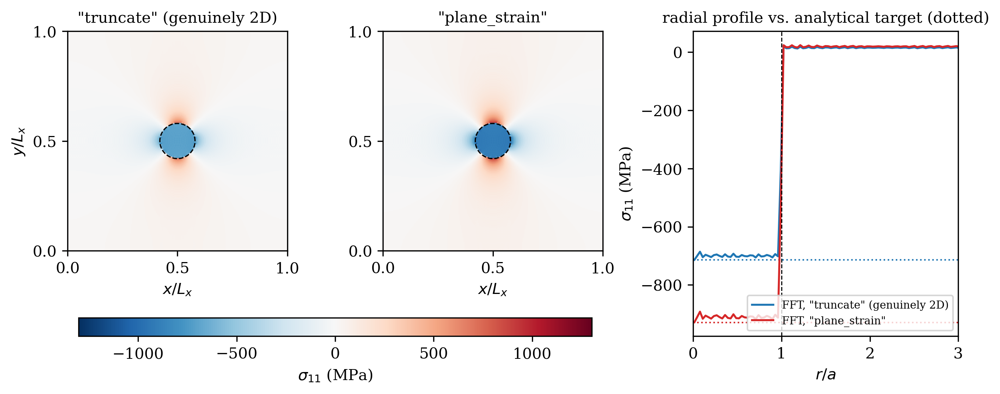

# Tutorial: The Plane-Strain Eigenstrain Closure for the 2D Elasticity Solver

Every real crystal is three-dimensional, but a simulation of one doesn't
have to be — it's common, and often necessary just to keep the computation
tractable, to evolve a precipitate's microstructure on a 2D grid: composition
and displacement fields that only ever vary in `x` and `y`, never in `z`.
The [coherent-Hessian tutorial](tutorial_coherent_hessian_quaternary.md)
never has to confront what that choice costs. It can evaluate a composition
wave along *any* direction \(\mathbf{n}\) it likes — Step 6 there scans the
entire unit sphere to find the softest one — but every one of those
directions lives in an infinite, fully 3D solid with no spatial grid at
all. There is simply never a third dimension to set aside, no matter how
many directions get checked. The phase-field solver this repository
actually runs for kinetics
(`phasefoundry.elasticity.fft_solver.solve_elasticity`) can't avoid the
question: every time it solves a genuinely 2D simulation of what is
physically a 3D crystal, it has to decide what happens to the part of the
problem living along `z`.

This tutorial works that decision out from first principles — what the
two standard choices are, how each one follows from Hooke's law, and how
to check either one against an independent reference. Along the way, the
new piece of physics turns out not to be new at all: it reduces exactly to
the \(Y(\mathbf{n})\) machinery the previous tutorial already built, once
specialized to an in-plane direction. The last step works through a
modeling detail that matters specifically once this new option is used —
kept in as a worked example, because seeing it worked through end to end
is more useful than simply being told about it in the abstract.

!!! note "Prerequisites"
    Steps 0–5 need nothing but the solver itself and a handful of made-up or
    production cubic elastic constants (no TDB, no CSV). Step 6 reads two
    files written by an already-completed simulation:

    - `results/HfNbTiV_BCC_PhaseForge_v2/NbHfTiV/500C/kinetics/pf_2d_c25Nb25Hf25Ti_kappa1e12_M5e21_tdbv2_elastic/fields.npz`
    - `.../elastic_params.yaml` (same directory)

    It does not re-run the kinetics — only re-solves the mechanical
    equilibrium problem once per saved snapshot.

---

## Step 0 — plane stress vs. plane strain, in the abstract

A composition field `c(x, y)` only varies in two directions, but the crystal
it represents still has a third one. Classical continuum mechanics has two
standard ways to collapse a 3D elasticity problem into 2D, and they are not
the same thing:

- **Plane stress** (\(\sigma_{33} = 0\)): appropriate for a thin, free-standing
  sheet — the top and bottom surfaces are free, so no stress can build up
  normal to them, and the sheet is free to thin or thicken (\(\varepsilon_{33}\)
  floats).
- **Plane strain** (\(\varepsilon_{33} = 0\)): appropriate for a slice through
  a *thick*, bulk solid, far from any free surface — the material above and
  below the slice clamps it, so it cannot move in the third direction at
  all, but it is perfectly free to develop whatever \(\sigma_{33}\) that
  clamping requires.

A 2D phase-field simulation of a precipitate growing inside a bulk alloy is
the second case, not the first — there's no free surface a few nanometers
away; the material in `z` is just more of the same bulk crystal.

`solve_elasticity`'s existing default, `eigenstrain_closure="in_plane_only"`, is
neither of these. It simply never computes an out-of-plane eigenstrain or
stiffness component at all — the 3×3 tensors get sliced down to 2×2 before
anything happens with them. That's not a modeling error introduced by this
codebase; it's the literal published algorithm this solver is based on
(Gururajan & Abinandanan, *Acta Materialia* 55 (2007) 5015, which works in
2D throughout and never discusses a closure by name). This tutorial adds
the other textbook option, plane strain, as a second, explicit choice
appropriate when the 2D simulation is meant to represent a slice through
bulk 3D material rather than a thin, free-standing sheet.

## Step 1 — what an eigenstrain is, from Vegard's law up

Swap some Nb atoms for Hf in a BCC lattice and the equilibrium lattice
parameter changes — Vegard's law treats this change as roughly linear in
composition. If a region's local composition "wants" a lattice spacing
different from its neighbors', but the crystal has to stay coherent (same
lattice across the interface, no dislocations), the region is forced away
from its own preferred size. The *stress-free strain* it would relax to if
cut free and allowed to relax — one number for how much bigger or smaller
it wants to be, applied equally in every direction for a cubic lattice —
is the eigenstrain \(\varepsilon^{*}_{ij} = \eta(c)\,\delta_{ij}\), the same
quantity Step 1 of the coherent-Hessian tutorial calls \(\eta\). It is a
genuine 3×3 tensor (`\varepsilon^*_{11} = \varepsilon^*_{22} = \varepsilon^*_{33} = \eta`
for an isotropic Vegard assumption), even though a 2D simulation only ever
asks about its `x` and `y` entries directly.

## Step 2 — where does the eigenstrain's z-component go in a 2D code?

Pose the question concretely. At every grid point, the composition field
implies a definite \(\varepsilon^*_{33}(x,y)\) — it's exactly the same
number as \(\varepsilon^*_{11}(x,y)\) and \(\varepsilon^*_{22}(x,y)\), just
along an axis the simulation doesn't track a displacement for. Three things
could happen to it:

1. **Ignore it** (`"in_plane_only"`): never compute it, never let it affect
   anything. This is the current default.
2. **Plane stress**: let \(\varepsilon_{33}\) float freely so
   \(\sigma_{33}=0\) — wrong physics here (Step 0), but worth naming so it's
   not confused with option 3.
3. **Plane strain**: fix \(\varepsilon_{33}=0\) exactly (no `z` displacement
   at all, consistent with "more bulk crystal above and below"), and let
   \(\sigma_{33}\) be whatever that constraint, combined with the real
   eigenstrain, requires — including feeding back into \(\sigma_{11}\) and
   \(\sigma_{22}\) through the material's Poisson-type coupling.

Option 1 is distinct from both textbook cases: it does not carry the
out-of-plane information that either one uses.

## Step 3 — deriving the plane-strain closure

Hooke's law for a cubic crystal, one component at a time, with
\(\varepsilon^{\rm el} = \varepsilon - \varepsilon^{*}\):

$$
\sigma_{33} = C_{12}\,\varepsilon^{\rm el}_{11} + C_{12}\,\varepsilon^{\rm el}_{22}
            + C_{11}\,\varepsilon^{\rm el}_{33}
$$

Plane strain imposes \(\varepsilon_{33}=0\) exactly, so
\(\varepsilon^{\rm el}_{33} = 0 - \varepsilon^{*}_{33} = -\varepsilon^{*}_{33}\).
That's enough to eliminate \(\sigma_{33}\) entirely — there is no need to
solve for a `z` displacement field, because the constraint already *is* the
answer for \(\varepsilon_{33}\). Substituting into the in-plane stress
components:

$$
\sigma_{11} = C_{11}\,\varepsilon^{\rm el}_{11} + C_{12}\,\varepsilon^{\rm el}_{22}
            + \underbrace{C_{12}\,\varepsilon^{\rm el}_{33}}_{=\,-C_{12}\,\varepsilon^{*}_{33}}
$$

The underbraced term is exactly what `"in_plane_only"` does not include. It is not a
small correction in general — it is the entire Poisson-type coupling that
makes a locked-in out-of-plane eigenstrain push back on the in-plane stress
at all. `solve_elasticity`'s `eigenstrain_closure="plane_strain"` option
adds precisely this term, as a constant correction to the in-plane stress
(`sigma_oop_correction` in the code — constant because it never depends on
the in-plane strain being solved for, so it's computed once, outside the
iteration loop, not an extra degree of freedom):

```python
C_io_full = C_field[..., :d, :d, :, :]          # (*spatial, d, d, 3, 3)
eps_el_oop = -eps_star_src.copy()
eps_el_oop[..., :d, :d] = 0.0                    # keep only the 33 (and 13, 23) entries
sigma_oop_correction = np.einsum("...ijkl,...kl->...ij", C_io_full, eps_el_oop)
```

## Step 4 — connecting it to Y(n)

This isn't a new theory bolted onto the coherent-Hessian tutorial's
machinery — it's a special case of it. For a cubic crystal with its axes
aligned to the grid and a wavevector confined to the `xy` plane,
\(\mathbf{n} = (n_1, n_2, 0)\), two facts about cubic symmetry combine to
make the full 3D \(Y(\mathbf{n})\) formula *already equal* the plane-strain
answer, exactly — not approximately:

1. **The acoustic tensor decouples.** \(A_{ik} = C_{ijkl}\,n_j n_l\) has no
   `13` or `23` entries for an axis-aligned cubic crystal (no coupling
   between a normal strain and a shear strain), so with \(n_3=0\) the
   `z`-row and `z`-column of \(A\) depend only on \(C_{44}\) and nothing
   else — they decouple completely from the in-plane \(2\times2\) block.
2. **The eigenstress has no `z`-component either.** \(\sigma^0 = C\!:\!I\)
   is diagonal for a cubic crystal, so \(v_i = \sigma^0_{ij} n_j\) has
   \(v_3 = \sigma^0_{33}\,n_3 = 0\) whenever \(n_3=0\).

Since `term2` in \(Y(\mathbf{n})\) is \(v \cdot \Omega(\mathbf{n}) \cdot v\)
and \(v_3=0\), the decoupled `z`-block of \(\Omega\) never enters the
calculation at all — only the in-plane \(2\times2\) sub-block does, and that
sub-block is identical to what you'd get solving the 2D plane-strain problem
directly. `term1` (\(C_{ijkl}\delta_{ij}\delta_{kl}\)) doesn't depend on
\(\mathbf{n}\) or on any solve at all — it's the same material constant
either way. So:

$$
Y_{\rm 3D}(\mathbf{n})\Big|_{n_3=0} \;=\; Y_{\rm plane\;strain}(\mathbf{n})
$$

exactly, for any in-plane direction and any cubic anisotropy. Step 5 checks
this two different ways.

## Step 5 — validating the closure

### Step 5a — a circular precipitate against the classical analytical solution

The most convincing check isn't an abstract Fourier mode — it's the same
kind of problem Gururajan & Abinandanan (2007) themselves validated their
solver against: a circular precipitate, with a known exact solution from
classical elasticity (Eshelby, Mura) to compare against. Set up the
simplest version of it: an isotropic material, shear modulus \(G\) and
Poisson's ratio \(\nu\), with a uniform dilatational eigenstrain
\(\varepsilon_0\) filling a circular region of radius \(a\) and *exactly
the same elastic constants* outside it — no stiffness contrast, so the
only thing being tested is the eigenstrain closure, not the solver's
handling of a material interface.

**Deriving both analytical answers by hand.** By symmetry the displacement
is purely radial, \(u_r(r)\). Outside the inclusion there's no eigenstrain,
and solving the axisymmetric equilibrium equation with "stress-free at
infinity" rules out the growing solution, leaving \(u_r^{\rm out}=B/r\).
Inside, "bounded at the origin" rules out the \(1/r\) part, leaving
\(u_r^{\rm in}=A\,r\) — notably a *uniform* strain, which is the classical
Eshelby property: a circular (or spherical, or any ellipsoidal) region with
uniform eigenstrain develops perfectly uniform stress and strain inside it,
for any radius. Matching \(u_r\) and the traction \(\sigma_{rr}\) at
\(r=a\) gives one equation for \(A\) (and hence the interior stress) in
each of the two cases:

- **Genuinely 2D** (no `z` at all — Gururajan & Abinandanan's own
  formulation, and this repo's `"in_plane_only"` closure once the material is
  isotropic): Hooke's law uses only the in-plane trace,
  \(\sigma_{rr}=\lambda(\varepsilon_{rr}+\varepsilon_{\theta\theta})+2\mu\varepsilon_{rr}\).
  Working through the matching conditions:
  $$
  \sigma_{rr}^{\rm in} = \sigma_{\theta\theta}^{\rm in}
  = -\frac{G}{1-\nu}\,\varepsilon_0
  $$
- **True plane strain** (\(\varepsilon_{zz}\equiv0\) imposed everywhere,
  but \(\varepsilon^{*}_{zz}=\varepsilon_0\) is still physically present,
  so \(\varepsilon^{\rm el}_{zz}=-\varepsilon_0\) is a nonzero, *fixed*
  elastic strain that enters Hooke's law's three-index trace even though no
  `z` displacement is ever solved for): the same matching procedure, now
  carrying that extra term through, gives
  $$
  \sigma_{rr}^{\rm in} = \sigma_{\theta\theta}^{\rm in}
  = -\frac{G(1+\nu)}{1-\nu}\,\varepsilon_0
  $$

Both are exact, closed-form, and independent of \(a\). Their ratio is
\(1+\nu\) — a clean, specific numerical prediction, derivable with pencil
and paper before running a single line of code: for \(\nu=0.3\),
`plane_strain` should come out exactly 1.3× `in_plane_only`.

**Checking the solver against both.** \(G=50\) GPa, \(\nu=0.3\),
\(\varepsilon_0=0.01\), a sharp circular eigenstrain field of radius
\(a=0.08 L_x\) on a 256×256 periodic grid, same `C_mat=C_ppt` everywhere
(homogeneous modulus):

```python
disk = (r < a).astype(float)                       # sharp indicator, r from domain center
eps_star_field = eps0 * disk[..., None, None] * np.eye(3)[None, None, ...]
out = solve_elasticity(disk, C, C, eps_star_field=eps_star_field,
                        Lx=Lx, eigenstrain_closure=closure)
```

| | analytical | FFT solver (\(a/L_x=0.08\)) | error |
|---|---|---|---|
| `in_plane_only` | −714.29 MPa | −700.01 MPa | +2.00% |
| `plane_strain` | −928.57 MPa | −910.02 MPa | +2.00% |
| ratio (plane_strain / in_plane_only) | 1.3000 | 1.3000 | — |



**Reading the result:** both closures land within 2% of their own
analytical target — each the *correct* target, not the same one — and the
1.3× ratio predicted by hand above reappears exactly in the simulated
numbers, to 4 significant figures. The ~2% gap isn't solver error: the
analytical formula assumes a single inclusion in a truly *infinite* matrix,
while the FFT solver sees a periodic array of inclusions (one per domain
image), so neighboring periodic copies perturb the field. Shrinking the
inclusion relative to the domain confirms this directly — the error tracks
\(a/L_x\), not grid resolution:

| \(a/L_x\) | error (either closure) |
|---|---|
| 0.12 | 4.53% |
| 0.08 | 2.00% |
| 0.05 | 0.71% |
| 0.03 | 0.13% |

(Doubling the grid resolution at fixed \(a/L_x\) changes the error by
\(<0.1\) percentage points — confirming it's a finite-domain-size effect,
not a discretization one.) This is the same ~1% ballpark of agreement
Gururajan & Abinandanan reported for their own circular/elliptical
precipitate checks against Mura's solutions.

### Step 5b — a single Fourier mode, for the real (anisotropic) material

The circular-precipitate check above only works cleanly for an isotropic
material — an anisotropic circular inclusion doesn't have as simple a
closed form. To check the closure for the actual cubic, anisotropic
production elastic constants, go back to the \(Y(\mathbf{n})\) connection
from Step 4 instead. Re-derive \(Y(\mathbf{n})\) using *only* the in-plane
\(2\times2\) acoustic-tensor block (no `z`-components anywhere in the
calculation), and compare against the full 3D formula from the
coherent-Hessian tutorial:

```python
def Y_planestrain_2x2(C, n2):
    n3 = np.array([n2[0], n2[1], 0.0]) / np.linalg.norm(n2)
    I3 = np.eye(3)
    sigma0 = np.einsum("ijkl,kl->ij", C, I3)
    term1  = np.einsum("ijkl,ij,kl->", C, I3, I3)
    A2     = np.einsum("abcd,b,d->ac", C[:2, :, :2, :], n3, n3)   # 2x2 only
    v2     = (sigma0 @ n3)[:2]
    term2  = v2 @ np.linalg.inv(A2) @ v2
    return (term1 - term2) / 2.0
```

Checked against `coherency_modulus(C, n)` for three materials (\(A_Z=0.7\),
\(A_Z=1.0\), and the production equiatomic value \(A_Z=1.52\)) at seven
in-plane angles each — every pair agrees to machine precision
(`rel.diff < 1e-12`), confirming Step 4's claim is exact, not approximate.

Then feed a single, exactly-representable Fourier-mode eigenstrain field,
\(\varepsilon^*(x,y) = \eta_0 \cos(\mathbf{k}\cdot\mathbf{r})\,\delta_{ij}\),
into `solve_elasticity(..., eigenstrain_closure="plane_strain")` on a
homogeneous medium, and compare its total elastic energy to the formula
above. A single mode (rather than a general microstructure, and unlike
Step 5a's sharp disk) sidesteps *both* the catastrophic cancellation that
made pointwise stress comparisons unreliable earlier in this closure's
development *and* the periodic-image error Step 5a has to live with — a
single mode already *is* exactly periodic, so there's no finite-domain
artifact to converge away.

Converting energy to \(Y\) needs the amplitude convention spelled out, not
assumed — getting this wrong is an easy, silent mistake. In the
zero-relaxation limit (hypothetically no elastic relaxation at all,
\(\varepsilon^{\rm el} = -\varepsilon^*\) everywhere), \(Y_{\rm unrelaxed} =
{\rm term1}/2\) by definition, while direct substitution gives
\(\langle u_{\rm el}\rangle = \tfrac{1}{2}\eta_0^2\,{\rm term1}\,\langle\cos^2\rangle
= \tfrac{1}{4}\eta_0^2\,{\rm term1} = \tfrac{1}{2} Y_{\rm unrelaxed}\,\eta_0^2\).
So the general relation is \(Y = 2\langle u_{\rm el}\rangle / \eta_0^2\) —
*not* \(4\langle u_{\rm el}\rangle/\eta_0^2\), which is what a naive
"energy = \(\tfrac12 Y \eta^2\), then divide out \(\langle\cos^2\rangle=\tfrac12\)
again" guess gives, because that \(\langle\cos^2\rangle\) factor is already
absorbed into how \(Y=({\rm term1}-{\rm term2})/2\) is defined. Getting this
wrong produces a reproducible, exact factor of 2 in the comparison — if a
validation like this one is ever off by exactly a clean integer factor
across every single test case, suspect the amplitude convention before the
solver.

With the relation correct, the FFT solver's energy matches this \(Y(\mathbf{n})\)
to \(\sim 10^{-15}\) relative error, for 3 materials × 3 directions (9/9).
The default `"in_plane_only"` closure, computed the same way but without the
out-of-plane correction, is consistently *lower* — e.g. 86.3 vs. 120.8 GPa
along \(\langle100\rangle\) for the production composition — giving a
concrete, quantitative sense of how the two closures differ rather than
just a qualitative statement that they do. All of this is
captured as a permanent regression test in `tests/test_plane_strain_closure.py`
(`TestPlaneStrainAnalytical`, `TestPlaneStrainFFTEnergy`,
`TestInPlaneOnlyDiffersFromPlaneStrain`).

## Step 6 — a worked pitfall on real simulation data

Applying this to an actual saved simulation (a quaternary run whose
`fields.npz` holds 61 composition snapshots) at first gave a result far
outside any physically reasonable range: `plane_strain`'s energy came out
**100,000× to 240,000× larger** than `in_plane_only`'s, varying with time
in a way the physics gives no reason to expect.

```
     t [s]   std(x_Hf)   U_in_plane_only   U_plane_strain (wrong)   ratio
      25000   5.96e-04        762.5           1.845e+08          241,991
     100000   8.37e-04       1739.6           1.846e+08          106,096
     200000   1.62e-03       6701.9           1.846e+08           27,540
     325000   4.07e-03      42909.5           1.846e+08            4,303
```

The reason: `FixedVegardModel.eps_star_field()` computes
\(\varepsilon^*(x) = \sum_k \alpha_k\, c_k(x)\) using the **absolute**
composition fields, not their deviation from the simulation's mean
composition \(c_0 = (0.25, 0.25, 0.25)\). Evaluated at `c0` itself, this
gives \(\varepsilon^*_{33} \approx \sum_k \alpha_k \cdot 0.25 \approx 0.065\)
— a 6.5% "eigenstrain," present even where the composition is exactly at
its mean and there is, physically, nothing to be strained about.

For `"in_plane_only"` this detail is invisible: a spatially uniform offset to
\(\varepsilon^*\) just shifts the macroscopic strain \(E\) by the same
constant and costs zero elastic energy, regardless of whether that offset
is "real" or an artifact of where the reference point was chosen. For
`"plane_strain"` it is not invisible — \(\varepsilon_{33}\) is pinned at
exactly 0 with no macroscopic degree of freedom to absorb *any* uniform
offset, so that spurious 6.5% gets locked in as if it were real, physically
meaningful strain energy, at every single grid point, independent of the
actual composition fluctuation the simulation is supposed to be measuring.

The fix is the same idea Step 1's Vegard's-law picture already implies: the
eigenstrain should be measured relative to the reference state the lattice
parameter \(a_{\rm ref}\) was defined against, i.e.
\(\varepsilon^*(x) = \sum_k \alpha_k\,(c_k(x) - c_{0,k})\), which is exactly
zero at the mean composition:

```python
c_dev = c_all - c0[:, None, None]
eps_star_full = model_3d.eps_star_field(c_dev, ndim=3)
```

With that correction, the same four snapshots give a stable, physically
reasonable result:

```
     t [s]   std(x_Hf)   U_in_plane_only   U_plane_strain   ratio
      25000   5.96e-04        761.7           1272.0        1.670
     100000   8.37e-04       1738.7           2926.4        1.683
     200000   1.62e-03       6701.9          11332.1        1.691
     325000   4.07e-03      42909.5          72869.4        1.698
```

A consistent ~1.67–1.70× across a 13× range of fluctuation amplitude — a
robust, amplitude-independent material effect, not noise. The lesson for
anyone else extending the `"in_plane_only"`-only production pipeline to use
`"plane_strain"`: check what your eigenstrain model does *at the mean
composition* before trusting it under this closure. A convention that is
completely harmless under `"in_plane_only"` is not automatically harmless under
`"plane_strain"`.

## Step 7 — result, and which closure to use

Converting that ~1.7× ratio to absolute terms puts it in context. At
500 °C, equiatomic, the purely chemical Hessian's smallest eigenvalue is
−39,095.6 J/mol (from the coherent-Hessian tutorial) — about
\(-3.67\times10^{9}\ {\rm J/m^3}\) once converted through this run's molar
volume. Even at the latest snapshot checked here (\(t=325{,}000\ {\rm s}\)),
the full plane-strain elastic energy is \(\sim 1.18\times10^{5}\ {\rm
J/m^3}\) — about five orders of magnitude smaller. Early on, while
composition fluctuations are still small, this correction stays
numerically modest next to the chemical driving force; both closures'
corrections grow together as decomposition proceeds toward finite
amplitude.

The qualitative direction of the effect is the more general takeaway: for
a purely dilatational eigenstrain (the case this whole tutorial has used),
every comparison here — the circular inclusion, the single Fourier mode,
and this real composition field — came out the same way, `plane_strain`
giving a *larger* coherency correction than `in_plane_only`. That's a
direct consequence of Step 3: the extra Poisson-type term only ever adds
resistance to the in-plane deformation; it never removes any. Knowing that
direction ahead of time is useful for interpreting either closure's
result: `in_plane_only` gives the smaller of the two coherency corrections
for this kind of eigenstrain, `plane_strain` the larger.

**Practical rule:** use `"in_plane_only"` when reproducing a published algorithm
exactly as described (it matches Gururajan & Abinandanan (2007) verbatim,
and is the production default for that reason). Use `"plane_strain"` when
the 2D simulation is meant to represent a slice through bulk 3D material
and the out-of-plane eigenstrain is physically present and non-negligible
— and when doing so, make sure the eigenstrain model is zeroed at the
simulation's actual mean composition first (Step 6).

---

## Where this leads

- **The Y(n) formula this closure turns out to be a special case of** — the
  [coherent-Hessian tutorial](tutorial_coherent_hessian_quaternary.md),
  Step 6.
- **The full anisotropic, composition-dependent elasticity this closure is
  a simplification of** — the
  [2D ternary elasto-chemical tutorial](tutorial_2d_ternary_elastic.md).
- **The solver itself** — `src/phasefoundry/elasticity/fft_solver.py`,
  `solve_elasticity(..., eigenstrain_closure=...)`.
