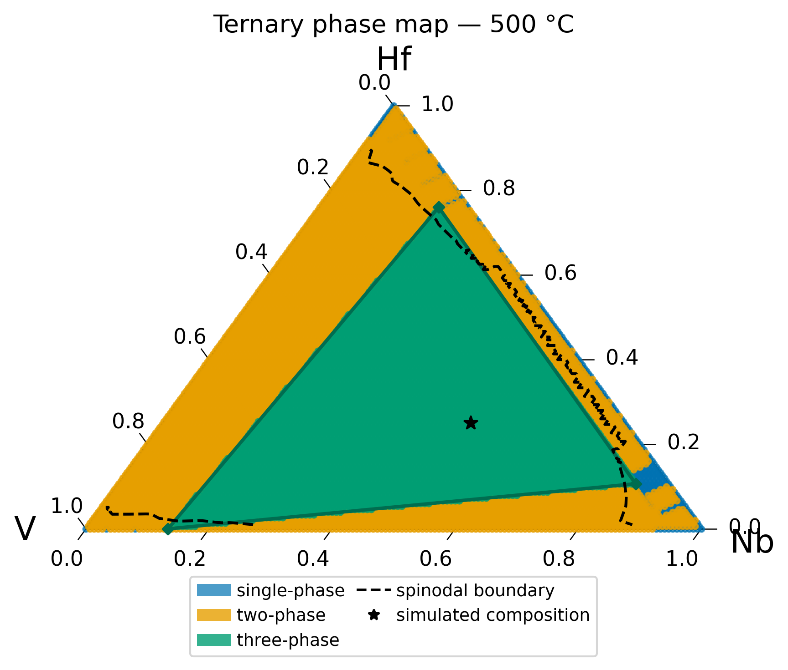
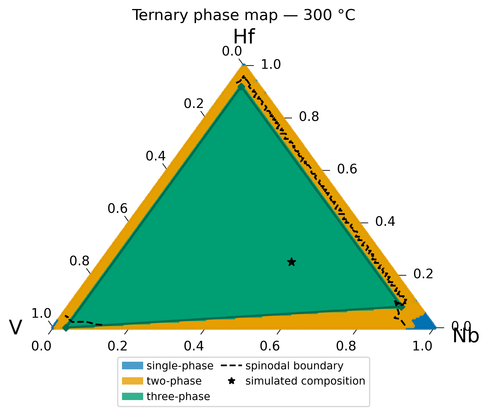
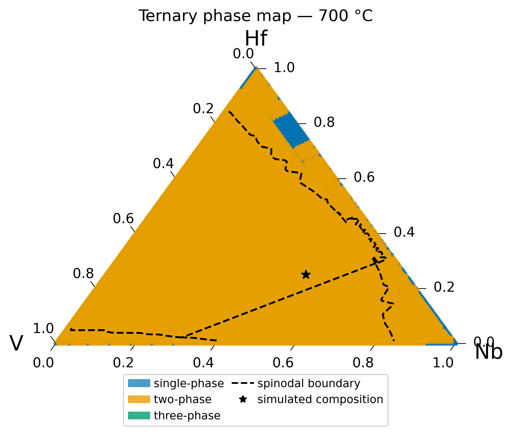
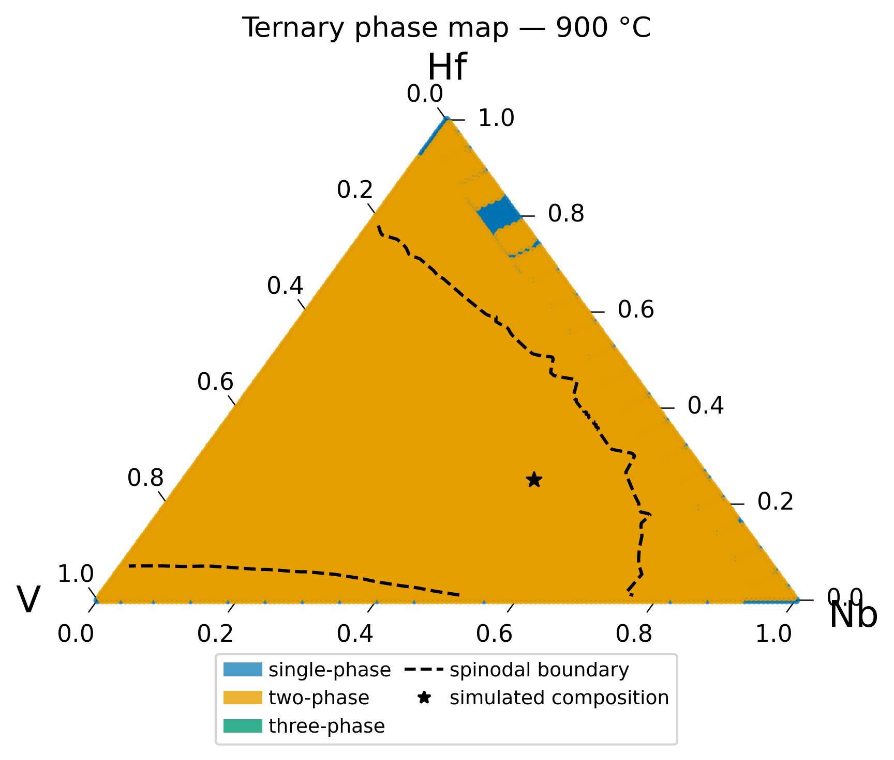

# Tutorial: tie-lines and phase maps (ternary Nb-Hf-V)

A two-phase equilibrium in a multicomponent alloy is defined by a
**tie-line**: the pair of compositions at which every component's chemical
potential is equal between the two phases. This is the quantity that
answers the question "if this alloy splits into two phases, what are they
made of?" — and it cannot be estimated by eye in a ternary or
higher-order system, since it depends on the full shape of the
multicomponent Gibbs energy surface, not merely the overall composition.

This matters here specifically because PhaseFoundry's elasto-chemical model
requires a real tie-line as input, not a free parameter: `c_mat`/`c_ppt`
set the two reference compositions between which the Vegard eigenstrain
model measures coherency strain, so if they do not correspond to an actual
equilibrium, the elastic driving force computed from them does not
correspond to anything physical either. `pf-tieline` exists to close
exactly that gap — it calls `pycalphad`'s equilibrium solver directly, at
the exact parent composition and temperature, and reports the real phase
split instead of a hand-picked estimate. This tutorial runs it for real,
alongside `pf-phase-map` for a wider composition-space view, and the result
proves more informative than simply replacing an imprecise placeholder
with a precise number.

## What these two commands actually compute

- **`pf-tieline`** calls `pycalphad.equilibrium()` once, at a single
  composition and temperature, and reports every stable phase instance
  found there.
- **`pf-phase-map`** scans the *entire* composition simplex and classifies
  every point by how many phase regions the lower convex hull of `G_m`
  resolves into (single-phase / two-phase / three-phase), drawing the
  result as a ternary diagram with the spinodal boundary and the
  simulation's mean composition overlaid.

These are independent implementations of related ideas — one answers "what
is stable *here*," the other answers "what is stable *everywhere*." Run
together, they cross-check each other, which is exactly what happens
below.

---

## Step 1c — what does CALPHAD actually say about Nb50Hf25V25 at 500 °C?

```bash
pf-tieline --config configs/nb_hf_v_elastic_cNb50V25Hf25.yaml
```

This is the real output, with nothing trimmed from the equilibrium
section:

```
System   : NB - HF - V
Phase    : BCC_A2
T        : 500 °C (773.15 K)
c0       : {'NB': 0.5, 'HF': 0.25}

=== Raw equilibrium output ===
  BCC_A2  fraction=0.2648
  BCC_A2  fraction=0.4544
  BCC_A2  fraction=0.2807

3 BCC_A2 phases found (3-phase equilibrium — not a simple two-phase tie-line).

=== Tie-line endpoints ===
  phase_0: x_NB=0.2316  x_HF=0.7631  x_V=0.0054
  phase_1: x_NB=0.8757  x_HF=0.1051  x_V=0.0192
  phase_2: x_NB=0.1451  x_HF=0.0006  x_V=0.8543

=== Suggested elastic config update ===
```

Two results are worth noting immediately:

1. **Three phase instances, not two.** The calculation found three
   simultaneously stable `BCC_A2` compositions, with comparable phase
   fractions (26%/45%/28%, not one dominant phase plus two numerical
   slivers) — a genuine three-phase equilibrium, not an artifact.
2. **The "suggested elastic config update" section is empty.** The
   script produces `c_mat`/`c_ppt` text only when exactly two phases are
   found (it sorts two endpoints into `mat`/`ppt` by phase fraction —
   majority is `mat`, minority is `ppt`; see the
   [binary tie-line tutorial](tutorial_binary_tieline.md#labeling-convention-matrix-vs-precipitate)); given three, it produces no suggestion.

Neither result indicates an error in the tie-line script — both convey
something true and specific: **at this exact composition and temperature,
the real equilibrium state is not a simple two-phase matrix/precipitate
split.** No pair of endpoints selected from a two-phase framework can be
"the" correct tie-line here, because the real answer has three vertices,
not two.

---

## Step 1d — examining the whole diagram

```bash
pf-phase-map --config configs/nb_hf_v_elastic_cNb50V25Hf25.yaml
```



The green triangle is the three-phase region `compute_ternary_phase_regions()`
identifies by taking the lower convex hull of the `G_m(x_Nb, x_Hf)`
surface, and the black star (the `simulation.c0` composition every
ternary-system tutorial on this site uses, Nb50Hf25V25) sits **inside it**,
not in the orange two-phase region surrounding it.

**The cross-check:** reading the green triangle's three corners directly
from this figure and comparing them to `pf-tieline`'s three endpoints
above shows agreement to plotting resolution: the top vertex
(~x_Hf=0.76, x_Nb=0.23) is `phase_0`; the right vertex (~x_Nb=0.88,
x_Hf=0.11) is `phase_1`; the bottom-left vertex (near the V corner) is
`phase_2` (x_V=0.854). Two independently implemented methods — a
single-point `pycalphad.equilibrium()` call and a whole-simplex
convex-hull scan — agree on the same answer. This indicates a real
three-phase field in this TDB's assessed Nb-Hf-V BCC_A2 system at 500 °C,
not an artifact of either method.

### Temperature dependence

The same command, run against the cached 300 °C, 700 °C, and 900 °C tables
in this `data_dir`, shows that the three-phase field is not a fixed
feature — it closes as temperature rises:

<div class="grid cards" markdown>

-   **300 °C**

    ---

    

    The three-phase region is *larger* here — it covers most of the
    diagram, and the star composition sits deep inside it.

-   **500 °C**

    ---

    

    The case examined above — the three-phase field is still present, the
    star just inside it.

-   **700 °C**

    ---

    

    The three-phase field has closed entirely — only single-phase and
    two-phase regions remain, and the star now falls in an ordinary
    two-phase region.

-   **900 °C**

    ---

    

    Further above the closure temperature — the spinodal dome itself has
    also shrunk substantially.

</div>

**Observation:** the three-phase field shrinks monotonically between
300 °C and 700 °C and has closed by 700 °C (the closure occurs somewhere
between 500 °C and 700 °C; these four cached temperatures do not resolve
the exact value — the same sampling-density limitation noted in the
[binodal/spinodal tutorial](tutorial_binodal_spinodal_3T.md#common-gotchas)).

**Interpretation:** this is consistent with a three-phase field bounded
above by an invariant-reaction temperature in this system's assessment —
below it, three `BCC_A2` composition sets coexist; above it, the system
reduces to the ordinary two-phase (or single-phase) behavior assumed by
the rest of this site's tutorials. This is not a claim about the real
physical Nb-Hf-V system — it is a property of this specific TDB
(`HfNbTiV_BCC_PhaseForge_v2_Tdep.tdb`) at this specific composition range,
the same caveat every other tutorial on this site states regarding its own
TDB-derived numbers.

---

## Implications for the elastic config

The [ternary tutorial](tutorial_2d_ternary_elastic.md)'s
`elastic.c_mat`/`elastic.c_ppt` values
(`{NB: 0.70, HF: 0.10, V: 0.20}` / `{NB: 0.15, HF: 0.35, V: 0.50}`) are not
merely numerically different from the real tie-line — they represent the
wrong *shape* of answer. The eigenstrain/Vegard framework that config
feeds is built for a two-phase matrix/precipitate microstructure, while the
real equilibrium at that composition is three-phase. A proper fix requires
either selecting a parent composition that sits outside the three-phase
field (any composition in the orange region of the 500 °C map above), or
extending the elastic model to handle three coexisting phases — simply
substituting `pf-tieline`'s numbers is insufficient, since for this exact
composition it produces no usable `mat`/`ppt` values at all.

---

## Common gotchas

| Symptom | Likely cause |
|---|---|
| `pf-tieline` raises `FileNotFoundError` for `db_path` when run from outside the repository root, or with a config file located somewhere other than directly under `configs/` | Unlike every other workflow (which resolves paths relative to the repository root via `resolve_paths()`), `workflows/01c_calphad_tieline/run.py` resolves `db_path` as `Path(config_path).parent.parent / db_path` — relative to the config file's own location, not the repository root. This functions correctly only for configs located directly in `configs/`. Tie-line configs should remain there, or an absolute `db_path` should be used. |
| `pf-tieline`'s "Suggested elastic config update" section is empty | More than two stable phases were found at that composition/temperature — see above. The raw equilibrium output's phase count should be checked before assuming the command has failed. |
| `pf-phase-map` shows more temperatures than the config lists | Same shared-`data_dir` caching behavior as `pf-surrogate` — see the [binodal/spinodal tutorial's Step 2 note](tutorial_binodal_spinodal_3T.md#step-2-fit-the-surrogate-and-compute-both-boundaries). |
| Three-phase region visible on the phase map but `pf-tieline` at a composition inside it reports only one or two phases | Possible if that exact composition lies exactly on a region boundary, or if a different temperature was used than the one shown on the map — `pf-tieline` should be re-run at the exact `(T, x)` being checked against the map. |

## Related material

- **The config this caveat applies to** — the [2D ternary elasto-chemical tutorial](tutorial_2d_ternary_elastic.md) runs the actual simulation with the placeholder `c_mat`/`c_ppt` values shown here to be the wrong shape of answer for this composition.
- **The Hessian behind the spinodal boundary drawn on these maps** — the [Hessian stability analysis tutorial](tutorial_hessian_stability_binary.md) (binary case; the same `min_eigenvalue()` machinery scales to this ternary map).
- **Full command reference** — [CLI Reference](cli_reference.md) for `pf-tieline` and `pf-phase-map` alongside every other `pf-*` command.
